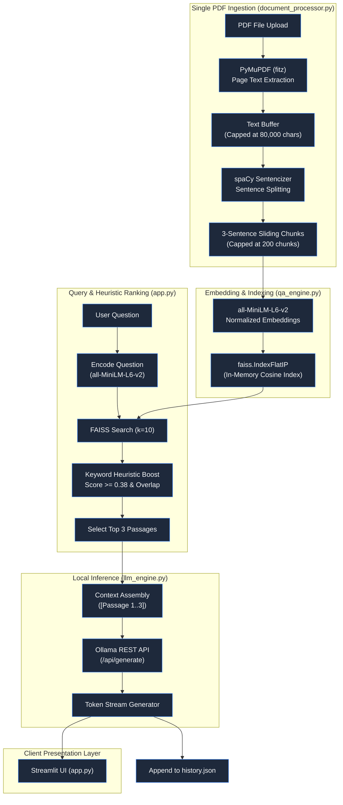
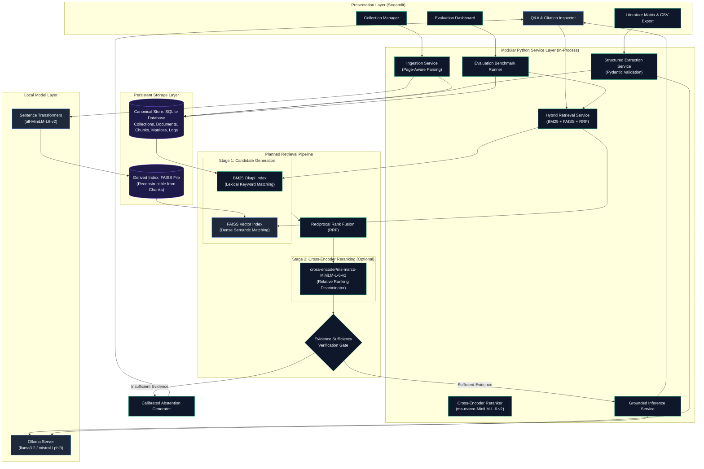
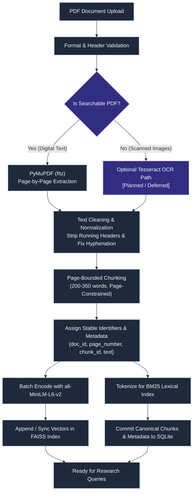
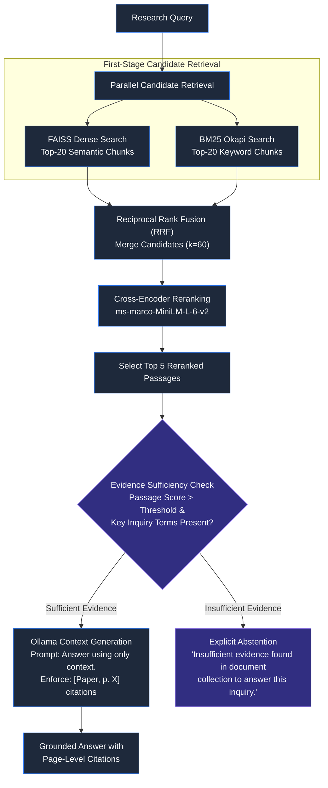
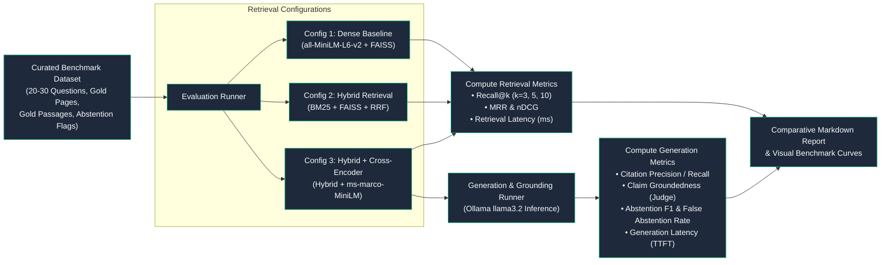
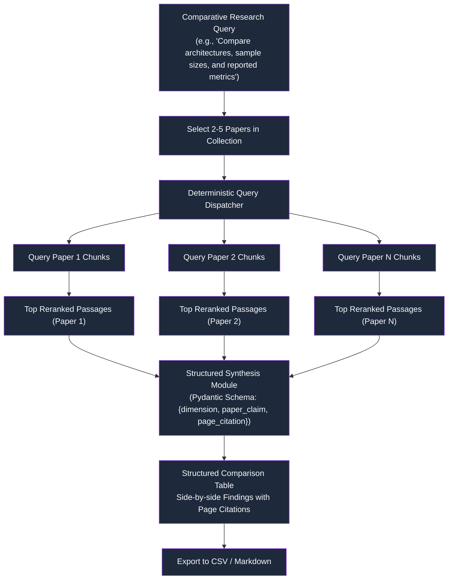
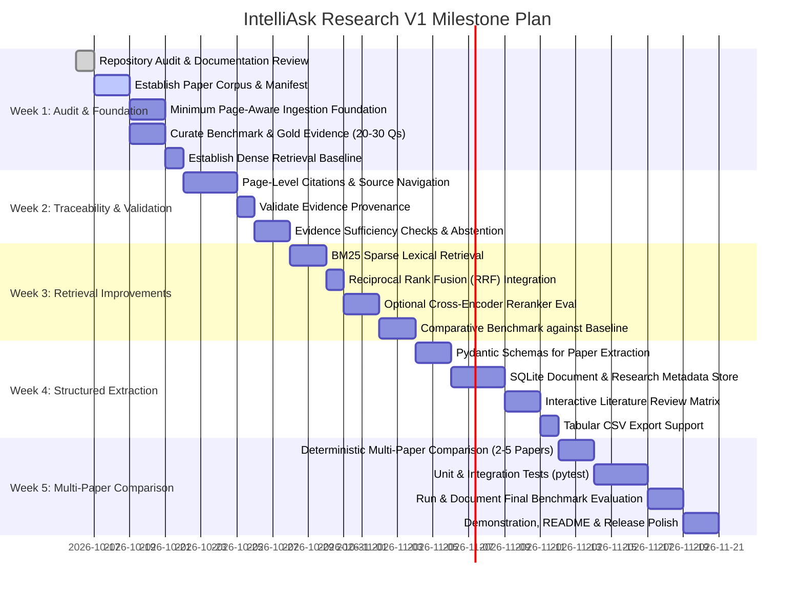

# IntelliAsk Research — Intelligent Question Answering System

> **A general-purpose, local-first scientific literature analysis platform that analyzes research PDFs, retrieves evidence with page-level traceability, compares retrieval strategies through reproducible evaluation, and organizes paper findings into an exportable literature matrix.**

[](https://www.python.org/)
[](https://streamlit.io/)
[](https://github.com/facebookresearch/faiss)
[](https://huggingface.co/sentence-transformers/all-MiniLM-L6-v2)
[](https://ollama.com/)
[](LICENSE)
[](#current-implementation-versus-roadmap)

---

## Implementation Status Overview

> [!NOTE]
> **Repository Audit Notice**: This repository currently houses a working single-document prototype featuring semantic search and local LLM streaming via Ollama. It is actively transitioning into **IntelliAsk Research (V1)** to support multi-document literature matrices, page-level citation verification, hybrid retrieval, and systematic IR benchmarking.
> 
> * **Current Working Implementation**: Single-PDF ingestion, spaCy sentence segmentation, in-memory FAISS indexing, heuristic keyword boosting, local Ollama streaming inference, and local JSON query logging.
> * **Target V1 Architecture**: Multi-paper project collections, page-level citation extraction, BM25 + Dense hybrid retrieval, Cross-Encoder reranking, Pydantic-validated literature extraction, and reproducible evaluation against standard IR metrics.
> * **Platform Scope**: A general-purpose scientific literature analysis system designed to operate across diverse research domains. Specific applied literature (such as automated road distress inspection, computer vision benchmarks, or NLP architectures) may serve as optional demonstration case studies.
> * Full architectural specifications, benchmark designs, and weekly milestones are tracked in [`docs/ARCHITECTURE.md`](docs/ARCHITECTURE.md), [`docs/EVALUATION.md`](docs/EVALUATION.md), and [`docs/ROADMAP.md`](docs/ROADMAP.md).

---

## Table of Contents

- [Overview](#overview)
  - [The Research Challenge](#the-research-challenge)
  - [General-Purpose Scientific Literature Analysis](#general-purpose-scientific-literature-analysis)
  - [Why Standard LLMs Fall Short](#why-standard-llms-fall-short)
  - [Retrieval-Augmented Generation (RAG)](#retrieval-augmented-generation-rag)
  - [Local-First Architecture & Privacy Nuance](#local-first-architecture--privacy-nuance)
  - [Evidence Traceability & Systematic Evaluation](#evidence-traceability--systematic-evaluation)
- [Current Implementation versus Roadmap](#current-implementation-versus-roadmap)
- [Key Features](#key-features)
  - [Currently Implemented Capabilities](#currently-implemented-capabilities)
  - [Planned V1 Research Capabilities](#planned-v1-research-capabilities)
  - [Core Differentiators](#core-differentiators)
- [System Architecture](#system-architecture)
  - [Diagram 1: Existing Prototype Architecture](#diagram-1-existing-prototype-architecture)
  - [Diagram 2: Planned V1 System Architecture](#diagram-2-planned-v1-system-architecture)
  - [Diagram 3: V1 Document Ingestion & Page-Bounded Chunking](#diagram-3-v1-document-ingestion--page-bounded-chunking)
  - [Diagram 4: Hybrid Retrieval, Grounding & Abstention](#diagram-4-hybrid-retrieval-grounding--abstention)
  - [Diagram 5: Empirical Evaluation Workflow](#diagram-5-empirical-evaluation-workflow)
  - [Diagram 6: Multi-Paper Research Comparison Workflow](#diagram-6-multi-paper-research-comparison-workflow)
- [Evaluation Methodology](#evaluation-methodology)
  - [Benchmark Corpus & Query Dataset](#benchmark-corpus--query-dataset)
  - [Retrieval Configurations Under Test](#retrieval-configurations-under-test)
  - [Quantitative Metrics](#quantitative-metrics)
  - [Automated Claim-Support Judges & Fallibility](#automated-claim-support-judges--fallibility)
- [Technology Stack](#technology-stack)
- [Installation and Setup](#installation-and-setup)
  - [Prerequisites](#prerequisites)
  - [Clone Repository](#clone-repository)
  - [Virtual Environment Setup](#virtual-environment-setup)
  - [Install Dependencies](#install-dependencies)
  - [Ollama Setup & Model Pull](#ollama-setup--model-pull)
  - [Run Application](#run-application)
  - [Troubleshooting Common Issues](#troubleshooting-common-issues)
- [Repository Structure](#repository-structure)
  - [Actual Existing Structure](#actual-existing-structure)
  - [Proposed Target V1 Structure](#proposed-target-v1-structure)
- [Limitations & Research Integrity](#limitations--research-integrity)
- [Phased Development Roadmap](#phased-development-roadmap)
  - [5-Week V1 Implementation Plan](#5-week-v1-implementation-plan)
  - [Explicitly Deferred Features (Post-V1 Scope)](#explicitly-deferred-features-post-v1-scope)
- [Screenshots & Demonstration](#screenshots--demonstration)
- [License, Acknowledgements & Author](#license-acknowledgements--author)
- [Final Project Summary](#final-project-summary)

---

## Overview

### The Research Challenge
Modern researchers navigate an overwhelming volume of published academic literature. Scientific papers are complex, dense artifacts characterized by domain-specific terminology, multi-column formatting, specialized tables, and nuanced empirical claims. Locating specific methodological parameters, dataset configurations, or quantitative findings across dozens of papers requires hours of manual searching.

### General-Purpose Scientific Literature Analysis
IntelliAsk Research is engineered as a domain-independent literature platform. Rather than building bespoke single-purpose tools for isolated topics, the architecture processes general scientific PDFs across computational, natural, and engineering sciences. 

While specialized collections (such as automated road distress inspection, computer vision benchmarks, or transformer architecture literature) can serve as optional case studies for demonstration, the underlying ingestion, indexing, and synthesis engines remain completely domain-neutral.

### Why Standard LLMs Fall Short
General-purpose commercial and open-source Large Language Models (LLMs) cannot serve as reliable research assistants on their own:
1. **Hallucination of Evidence**: Parametric memory in LLMs tends to fabricate plausible-sounding citations, non-existent papers, or inaccurate empirical scores.
2. **Knowledge Cutoffs**: Frontier models lack awareness of recent preprints or specialized technical reports.
3. **Absence of Traceability**: Conventional chat completions generate unstructured answers without verifiable links back to exact page numbers or paragraph boundaries in the source text.

### Retrieval-Augmented Generation (RAG)
Retrieval-Augmented Generation (RAG) resolves these fundamental limitations by transforming the LLM from an ungrounded generator into an evidence-constrained synthesis engine. Instead of relying on pre-trained weights to answer factual questions, the system extracts, indexes, and retrieves the most relevant passages from the user's specific PDF collection, providing them as strict context in the model prompt.

### Local-First Architecture & Privacy Nuance
IntelliAsk Research runs inference, embedding generation, and vector indexing locally on user hardware via **Ollama**, **Sentence Transformers**, and **FAISS**.

> [!NOTE]
> **Privacy & Security Nuance**: Local-first processing eliminates the transmission of sensitive manuscripts, unpublished preprints, or proprietary data to third-party cloud APIs. However, running locally reduces external service dependency but does not automatically guarantee total security under every configuration; host systems remain subject to local operating system access controls, network policies, and file permissions.

### Evidence Traceability & Systematic Evaluation
Unlike casual document chat tools, IntelliAsk Research emphasizes:
- **Page-Level Grounding**: Every claim is mapped to specific source pages (`[Paper, p. X]`).
- **Calibrated Abstention**: The system is designed to withhold answers when retrieved evidence is insufficient, mitigating false confidence.
- **Measurable Information Retrieval**: Alternative retrieval pipelines (dense baseline, hybrid BM25, and reranked search) are evaluated using reproducible metrics (Recall@k, MRR, nDCG, Groundedness) rather than subjective impressions.

---

## Current Implementation versus Roadmap

The following status matrix audits the repository's current codebase against the planned V1 target state:

| Feature / Capability | Audit Status | Current Codebase Implementation | V1 Target State |
| :--- | :--- | :--- | :--- |
| **PDF Upload & Extraction** | **Implemented** | PyMuPDF extracts text; concatenates into buffer (capped at 80,000 chars). | Page-aware extraction preserving page numbers, headers, and bounding coordinates. |
| **Semantic Embeddings** | **Implemented** | `all-MiniLM-L6-v2` encodes 3-sentence chunks into 384-d normalized vectors. | Maintained; extended to support batch processing and persistent caching. |
| **FAISS Vector Indexing** | **Implemented** | In-memory `faiss.IndexFlatIP` performing cosine similarity search. | Persistent disk-backed FAISS index linked to document collections. |
| **Local LLM Inference** | **Implemented** | Local HTTP requests to Ollama API (`/api/generate`) with model select. | Structured generation with strict context grounding and citation prompts. |
| **Streaming Responses** | **Implemented** | Token-by-token streaming via Python generator into `st.write_stream`. | Maintained; integrated with real-time citation parsing. |
| **Supporting Passages & Scores**| **Implemented** | Displays top passage cards with relevance scores (`SCORE_THRESHOLD = 0.38`). | Verified passage snippets displaying exact page numbers and reranker scores. |
| **Persistent Query History** | **Implemented** | Appends query, response, and top chunks into flat `history.json`. | Normalized local SQLite database linking queries, answers, and cited chunk IDs. |
| **Multi-PDF Collections** | **Planned for V1** | Single PDF in-memory index; new upload resets state. | Multi-paper collections with cross-document search and collection management. |
| **Page-Level Citations** | **Planned for V1** | Source limited to file name (`uploaded_file.name`); page numbers discarded. | Exact page citations (`[Title, p. X]`) validated against source chunks. |
| **Hybrid Retrieval (BM25)** | **Planned for V1** | Rudimentary keyword matching heuristic adds `0.15 * count` to FAISS score. | Principled BM25 Okapi sparse index fused with FAISS via Reciprocal Rank Fusion (RRF). |
| **Cross-Encoder Reranking** | **Planned for V1** | Not implemented; relies solely on bi-encoder dot-product scores. | Second-stage reranking via `cross-encoder/ms-marco-MiniLM-L-6-v2`. |
| **Insufficient Evidence Gate** | **Planned for V1** | Fallback message triggered if no chunks exceed score threshold. | Verified evidence sufficiency check and calibrated abstention generator. |
| **Structured Paper Extraction** | **Planned for V1** | Not implemented. | Pydantic-validated extraction of methodology, datasets, and primary findings. |
| **Literature Review Matrix** | **Planned for V1** | Not implemented. | Interactive multi-paper comparison matrix with one-click CSV export. |
| **Reproducible IR Evaluation** | **Planned for V1** | No evaluation harness or ground-truth dataset present. | Automated benchmark pipeline evaluating Recall@k, MRR, nDCG, and latency. |
| **Research Comparison Flow** | **Planned for V1** | Not implemented. | Controlled deterministic pipeline synthesizing findings across selected papers. |
| **Online Paper Discovery** | **Future Roadmap** | Not implemented. | Explicitly deferred outside V1 (avoids external API rate limits and network lock). |
| **React / TypeScript Rewrite** | **Future Roadmap** | Not implemented. | Explicitly deferred outside V1 (Streamlit is primary UI for V1). |
| **Autonomous Multi-Agent Loops**| **Future Roadmap** | Not implemented. | Explicitly deferred outside V1 (avoids non-deterministic agent loop instability). |

---

## Key Features

### Currently Implemented Capabilities
- **Local PDF Processing**: Upload and parse documents locally without cloud transmission using PyMuPDF and spaCy sentence segmentation.
- **Fast Semantic Vector Search**: Embeds chunks using `all-MiniLM-L6-v2` and searches vectors via an in-memory `faiss.IndexFlatIP` index.
- **Local LLM Integration via Ollama**: Supports local inference across models such as `llama3.2`, `llama3.2:1b`, `mistral`, `phi3`, and `gemma2`.
- **Token Streaming UI**: Interactive Streamlit interface with real-time response generation.
- **Relevance Scoring & Passage Inspector**: View retrieved passages alongside computed cosine similarity metrics.
- **Local History Logging**: Automatically preserves questions, generated answers, and retrieved source chunks in a local JSON log (`history.json`).

### Planned V1 Research Capabilities
- **Multi-Document Research Collections**: Group related papers into named research collections for cross-document query execution.
- **Page-Level Grounding**: Verifiable citations mapping directly to source pages and paragraph offsets.
- **Two-Stage Hybrid Retrieval & Reranking**: Combines BM25 lexical precision with dense semantic recall, refined by a cross-encoder reranker for maximum relevance.
- **Calibrated Abstention (Skeptic Mode)**: Detects when the retrieved context cannot substantiate an answer and explicitly abstains rather than inventing answers.
- **Structured Literature Review Matrix**: Automatically parses uploaded papers into structured schemas (Problem, Method, Dataset, Findings, Limitations) and exports results to CSV.
- **Deterministic Multi-Paper Comparison**: Executes side-by-side synthesis across multiple papers without relying on opaque autonomous agent loops.
- **Reproducible Evaluation Benchmark**: Built-in benchmark suite measuring retrieval recall, ranking precision, and groundedness across alternative configurations.

### Core Differentiators

```text
┌─────────────────────────────────────────────────────────────────────────────┐
│                            CORE DIFFERENTIATORS                             │
├──────────────────────────────┬──────────────────────────────┬───────────────┤
│ 1. Local-First Execution     │ 2. Grounded Traceability     │ 3. IR Benchmark│
│ Local execution eliminates   │ Answers cite exact pages;    │ Empirically   │
│ external cloud transmission; │ system abstains when         │ compares dense│
│ inference via Ollama & FAISS.│ evidence is insufficient.    │ vs hybrid vs  │
│                              │ Reduces ungrounded claims.   │ reranked IR.  │
└──────────────────────────────┴──────────────────────────────┴───────────────┘
```

---

## System Architecture

### Diagram 1: Existing Prototype Architecture
*Status: Implemented in current codebase (`app.py`, `src/`)*  
The diagram below represents the exact flow currently running in the repository:



---

### Diagram 2: Planned V1 System Architecture
*Status: Planned for V1 (Decoupled Services, Multi-Stage Retrieval, SQLite Canonical Storage)*  
The target V1 architecture decouples frontend rendering from retrieval services, provides multi-document persistence, and integrates an empirical evaluation runner:



---

### Diagram 3: V1 Document Ingestion & Page-Bounded Chunking
*Status: Planned for V1 (Includes failure handling and planned OCR path)*



---

### Diagram 4: Hybrid Retrieval, Grounding & Abstention
*Status: Planned for V1 (Includes two-stage retrieval and calibrated abstention path)*



---

### Diagram 5: Empirical Evaluation Workflow
*Status: Planned for V1 (Reproducible IR and Generation Benchmark)*



---

### Diagram 6: Multi-Paper Research Comparison Workflow
*Status: Planned for V1 (Controlled deterministic pipeline, non-agentic)*



---

## Evaluation Methodology

### Benchmark Corpus & Query Dataset
To ensure evaluation is scientifically grounded, the initial benchmark will be constructed from **approximately 5–10 carefully selected peer-reviewed scientific papers** across a manageable research domain.

The benchmark dataset consists of **approximately 20–30 curated questions** covering three query modalities:
1. **Factoid Queries**: Precise architectural hyperparameters, dataset counts, and reported benchmark scores.
2. **Synthesis Queries**: Cross-paragraph explanations of methods, loss functions, and ablation findings.
3. **Negative Queries (Abstention Tests)**: Questions that sound plausible but are absent from the papers, testing the system's ability to abstain rather than hallucinating unsupported facts.

Each benchmark record conforms to the schema documented in [`docs/EVALUATION.md`](docs/EVALUATION.md).

> [!NOTE]
> **Illustrative Template Record**:
> ```json
> {
>   "id": "q-demo-001",
>   "question": "What is the primary evaluation metric and reported score for the baseline model on the test split?",
>   "query_type": "factoid",
>   "target_paper_ids": ["sample_study_2024.pdf"],
>   "gold_pages": [6],
>   "gold_evidence_spans": [
>     "On the primary test split, the baseline architecture achieved a mean Average Precision (mAP@0.5) of 68.2% across all evaluation categories."
>   ],
>   "key_facts": ["mAP@0.5 metric", "score of 68.2%"],
>   "evidence_sufficient": true,
>   "reference_answer": "The baseline model achieves an mAP@0.5 score of 68.2% on the primary test split."
> }
> ```
> *The record above illustrates the schema format. Actual benchmark records will be populated from verified papers during the Week 1 milestone.*

### Retrieval Configurations Under Test
The evaluation harness compares three configurations against identical test queries and document splits:
1. **Semantic Baseline**: Dense retrieval via `all-MiniLM-L6-v2` and FAISS `IndexFlatIP`.
2. **Hybrid Retrieval**: BM25 Okapi lexical retrieval combined with FAISS dense retrieval via Reciprocal Rank Fusion (RRF).
3. **Hybrid + Cross-Encoder Reranking**: Hybrid candidate pool reranked using `cross-encoder/ms-marco-MiniLM-L-6-v2`.

### Quantitative Metrics

```text
┌───────────────────────────────────────┬───────────────────────────────────────┐
│          RETRIEVAL METRICS            │      ANSWER GENERATION METRICS        │
├───────────────────────────────────────┼───────────────────────────────────────┤
│ • Recall@k (k=3, 5, 10): % gold       │ • Citation Precision: % citations     │
│   evidence spans captured in top-k    │   pointing to correct gold pages      │
│ • Precision@k: % retrieved passages   │ • Citation Recall: % gold pages cited │
│   that contain relevant evidence      │ • Answer Groundedness: Claim-level    │
│ • MRR (Mean Reciprocal Rank): Rank    │   support score from retrieved context│
│   of first passage with gold evidence │ • Balanced Abstention: Abstention F1, │
│ • nDCG: Graded relevance ranking      │   True Negative Rate & False Refusal  │
│ • Retrieval Latency: Mean / p95 (ms)  │ • End-to-End Latency: Time-to-first-  │
│                                       │   token (TTFT) and total seconds      │
└───────────────────────────────────────┴───────────────────────────────────────┘
```

> [!IMPORTANT]
> **No Fabricated Benchmarks**: All quantitative metrics are currently marked **[Pending Run]** until the Week 1–3 evaluation milestones are executed against real paper corpora. The complete benchmark specification is documented in [`docs/EVALUATION.md`](docs/EVALUATION.md).

### Automated Claim-Support Judges & Fallibility
For automated evaluation of answer groundedness, an LLM-as-a-judge prompt decomposes generated answers into atomic claims and verifies each against retrieved passages. 

**Recognized Fallibilities of LLM Judges**:
- **Verbosity Bias**: Judges systematically favor longer answers over concise ones.
- **Self-Enhancement Bias**: Models often rate completions generated by their own family higher.
- **Verification Protocol**: Automated judge scores are treated as directional heuristics and will be supplemented by 100% human-verified spot checking on the final benchmark test split.

---

## Technology Stack

| Layer | Component / Library | Purpose | Implementation Status |
| :--- | :--- | :--- | :--- |
| **Language** | Python 3.10+ | Core language runtime | **Installed / Current** |
| **UI Framework** | Streamlit | Web interface, file upload, and token streaming | **Installed / Current** |
| **PDF Extraction** | PyMuPDF (`fitz`) | High-speed text and layout extraction from PDFs | **Installed / Current** |
| **NLP Preprocessing** | spaCy (`en_core_web_sm`) | Sentence boundary segmentation and linguistic analysis | **Installed / Current** |
| **Dense Embeddings** | Sentence Transformers | Computes 384-dimensional dense vectors (`all-MiniLM-L6-v2`) | **Installed / Current** |
| **Vector Search** | FAISS CPU (`IndexFlatIP`)| Cosine similarity nearest-neighbor search | **Installed / Current** |
| **Local LLM Engine** | Ollama | Local inference for Llama 3.2, Mistral, Phi-3, Gemma 2 | **Installed / Current** |
| **Local Persistence** | `history.json` | Flat JSON query history logging | **Installed / Current** |
| **Canonical Storage** | SQLite 3 | Normalized database for documents, chunks, and matrices | **Planned for V1** |
| **Sparse Retrieval** | `rank-bm25` | Lexical keyword search for hybrid candidate generation | **Planned for V1** |
| **Cross-Encoder** | `cross-encoder/ms-marco-MiniLM-L-6-v2` | Deep cross-attention passage reranking | **Planned for V1** |
| **Schema Validation** | Pydantic v2 | Strict validation of structured paper extractions | **Planned for V1** |
| **Test Harness** | `pytest` | Unit, integration, and evaluation regression tests | **Planned for V1** |

> *Note: External frameworks like LangGraph, PostgreSQL, React, and external paper crawlers are explicitly excluded from the required V1 stack.*

---

## Installation and Setup

### Prerequisites
- **Python**: Version 3.10 or higher.
- **Ollama**: Installed and running locally. [Download Ollama](https://ollama.com/download).
- **RAM / GPU**: 8GB RAM minimum (16GB recommended for running 3B–7B models locally).

### Clone Repository
```bash
git clone https://github.com/Shivangid2904/Intelligent-Question-Answering-System.git
cd Intelligent-Question-Answering-System
```

### Virtual Environment Setup
```bash
# Windows (PowerShell)
python -m venv venv
.\venv\Scripts\Activate.ps1

# Linux / macOS
python3 -m venv venv
source venv/bin/activate
```

### Install Dependencies
```bash
pip install --upgrade pip
pip install -r requirements.txt
```

If the spaCy model is not automatically downloaded from the wheel in `requirements.txt`, install it manually:
```bash
python -m spacy download en_core_web_sm
```

### Ollama Setup & Model Pull
Ensure the Ollama desktop application or daemon is active:
```bash
# Verify Ollama is running
curl http://localhost:11434

# Pull a supported lightweight model
ollama pull llama3.2:1b

# Or pull the higher-quality 3B default model
ollama pull llama3.2
```

### Run Application
Launch the Streamlit interface:
```bash
streamlit run app.py
```
The application will open in your browser at `http://localhost:8501`.

### Troubleshooting Common Issues
- **`Cannot connect to Ollama`**: Ensure Ollama is running in your taskbar or terminal. Run `ollama list` in a separate shell to confirm.
- **`Model not found`**: Ensure the model selected in the Streamlit sidebar matches an installed model. Run `ollama pull <model-name>` as displayed in the UI.
- **`PyMuPDF / fitz extraction error`**: Ensure the uploaded PDF is not password-protected or corrupted. Note that scanned image-only PDFs require the planned OCR path.

---

## Repository Structure

### Actual Existing Structure
The repository currently contains the working prototype implementation:

```text
Intelligent-Question-Answering-System/
├── .gitignore               # Excludes virtual environments, pycache, history.json, indices
├── README.md                # Project documentation and roadmap
├── app.py                   # Streamlit user interface and query orchestration
├── history.json             # Local JSON query history log
├── requirements.txt         # Core dependencies (Streamlit, PyMuPDF, spaCy, FAISS, etc.)
└── src/                     # Core application package
    ├── __init__.py          # Package initialization
    ├── document_processor.py# PyMuPDF extraction and spaCy chunking
    ├── llm_engine.py        # Ollama REST streaming generator
    └── qa_engine.py         # all-MiniLM-L6-v2 embeddings and FAISS search
```

### Proposed Target V1 Structure
The target V1 architecture reorganizes the repository into distinct service modules, persistent database schemas, and a dedicated evaluation harness:

```text
Intelligent-Question-Answering-System/
├── docs/                        # Detailed architectural and evaluation documentation
│   ├── ARCHITECTURE.md          # Technical specifications and sequence diagrams
│   ├── EVALUATION.md            # Benchmark design, schemas, and metric definitions
│   └── ROADMAP.md               # 5-week phased milestone plan and deferred features
├── data/                        # Local data and evaluation storage (git-ignored)
│   ├── benchmark/               # Benchmark query JSON and gold standard annotations
│   └── collections/             # Local SQLite database and persistent FAISS indices
├── src/                         # Modular service layer (in-process Python packages)
│   ├── __init__.py
│   ├── ingestion/               # Page-aware ingestion & metadata extraction
│   │   ├── __init__.py
│   │   ├── pdf_loader.py        # PyMuPDF page extractor with header/footer stripping
│   │   └── chunker.py           # Page-bounded sliding window chunker
│   ├── retrieval/               # Two-stage hybrid retrieval engine
│   │   ├── __init__.py
│   │   ├── dense_index.py       # FAISS vector store wrapper
│   │   ├── bm25_index.py        # BM25 Okapi lexical index wrapper
│   │   ├── hybrid_fusion.py     # Reciprocal Rank Fusion (RRF) logic
│   │   └── reranker.py          # Cross-Encoder passage reranker
│   ├── synthesis/               # LLM inference and grounded synthesis
│   │   ├── __init__.py
│   │   ├── prompt_templates.py  # Evidence-grounded prompts and citation rules
│   │   ├── sufficiency_gate.py  # Evidence thresholding and abstention logic
│   │   └── extraction_models.py # Pydantic schemas for scientific paper extraction
│   └── storage/                 # Local persistence layer
│       ├── __init__.py
│       └── db.py                # SQLite ORM / schema manager
├── evaluation/                  # Automated evaluation suite
│   ├── run_benchmark.py         # Benchmark execution script across configurations
│   ├── metrics.py               # Recall, MRR, nDCG, and citation accuracy calculators
│   └── claim_judge.py           # Claim-level groundedness verification judge
├── tests/                       # Unit and integration test suite
│   ├── test_chunker.py          # Tests for page-level metadata retention
│   ├── test_retrieval.py        # Tests for FAISS, BM25, and RRF consistency
│   └── test_sufficiency.py      # Tests for abstention on unanswerable questions
├── app.py                       # Modular Streamlit multi-page interface
├── requirements.txt             # Updated dependency specifications
└── .gitignore
```

---

## Limitations & Research Integrity

To uphold scientific rigor, the system's operational boundaries and known failure modes are transparently documented:

1. **PDF Layout Complexities**: PyMuPDF extraction can encounter difficulty with complex multi-column scientific layouts, sidebars, inline mathematical formulas, or embedded LaTeX tables. Scanned PDFs without OCR cannot be processed.
2. **Small Local LLM Nuances**: Running 1B to 3B parameter models locally provides accessibility and privacy, but these smaller models exhibit higher rates of reasoning degradation and can struggle with strict JSON schema compliance compared to 70B+ models.
3. **Similarity Score != Factual Truth**: A high cosine similarity score (e.g., 0.85) signifies semantic proximity in vector space; it does **not** guarantee that the retrieved passage factually answers the user's research query.
4. **Retrieval Sufficiency Gaps**: In complex scientific synthesis, a retrieved chunk may mention the correct topic but omit critical experimental controls or baseline assumptions.
5. **Cross-Encoder Latency**: Cross-encoders require pairwise neural evaluation of query-passage pairs, increasing CPU/GPU inference latency compared to fast bi-encoder dot-products.
6. **Benchmark Representativeness**: Evaluation results depend heavily on the diversity of the test corpus; findings on one subcorpus may not generalize automatically to other scientific fields.

---

## Phased Development Roadmap

### 5-Week V1 Implementation Plan
The target plan below establishes an evaluation-driven sequence for delivering IntelliAsk Research V1:



- **Week 1 (Audit & Evaluation Foundation)**: Complete repository audit and documentation review (`done`); establish initial paper corpus manifest of 5–10 carefully selected papers (`planned`); implement minimum page-aware ingestion (`planned`); curate 20–30 benchmark QA pairs with gold evidence (`planned`); establish dense retrieval baseline (`planned`).
- **Week 2 (Traceability & Validation)**: Implement page-level citations (`[Paper, p. X]`) and interactive source navigation; validate evidence provenance; introduce evidence sufficiency checks and calibrated abstention behavior; evaluate answerable and unanswerable questions.
- **Week 3 (Retrieval Improvements)**: Add BM25 lexical retrieval; combine with dense vectors using Reciprocal Rank Fusion; evaluate optional cross-encoder reranker; run comparative benchmark against Week 1 baseline.
- **Week 4 (Structured Extraction)**: Implement validated structured extraction using Pydantic schemas; add SQLite persistence as canonical document and research metadata store; build interactive literature matrix; support CSV export.
- **Week 5 (Multi-Paper Comparison & Release)**: Implement deterministic comparison across approximately 2–5 selected papers; add unit and integration tests (`pytest`); run and document final benchmark evaluation; finalize release demonstration and documentation.

### Explicitly Deferred Features (Post-V1 Scope)
The following capabilities are deliberately deferred to keep V1 focused and reliable:
- **Online Paper Discovery**: Direct scraping/crawling of arXiv, Semantic Scholar, or CrossRef APIs.
- **React / TypeScript Frontend**: Replacing the current Streamlit UI with an independent SPA frontend.
- **Autonomous Multi-Agent Orchestration**: Unbounded agent loops (e.g., LangGraph, AutoGen) that introduce unpredictable execution times and hallucination risk.
- **Paper Writing Assistant**: Features aimed at generating manuscript prose rather than analyzing literature.
- **Experiment Code Execution**: Sandboxed Python execution environments for running ML code snippets from papers.

---

## Screenshots & Demonstration

### Current Working Prototype

| View | Screenshot | Description |
| :--- | :--- | :--- |
| **Home Interface** |  | Landing page providing local model selection (`llama3.2`, etc.), PDF upload zone, and question input. |
| **Document Upload & Model Selection** |  | Document indexing status indicator and real-time model switching without application restarts. |
| **Grounded AI Answer** |  | Streaming response synthesized by the local LLM using retrieved context passages. |
| **Passages & History** |  | Transparency cards showing retrieved passage snippets, relevance scores, and persistent history. |

### Video Walkthrough
- **Full Prototype Walkthrough**: [Watch Google Drive Demo Video](https://drive.google.com/file/d/1q8-x_RziRFKCrJf_UVMTwpO0EpHAUsKa/view?usp=sharing)

### Visual Asset Update Roadmap (Post-V1)
- [ ] Capture screenshot of Multi-Paper Collection Manager (Week 2).
- [ ] Capture screenshot of Page-Level Citation Inspector with PDF snippet overlay (Week 2).
- [ ] Capture screenshot of Literature Review Matrix with CSV Export (Week 4).
- [ ] Capture screenshot of Evaluation Benchmark Dashboard showing Recall@k curves (Week 5).

---

## License, Acknowledgements & Author

### License
This project is licensed under the **MIT License**. See the repository metadata for details.

### Acknowledgements
IntelliAsk Research is made possible by the following open-source projects:
- **[Streamlit](https://streamlit.io/)** — Fast interactive UI development for machine learning.
- **[Ollama](https://ollama.com/)** — Local large language model execution and streaming.
- **[FAISS](https://github.com/facebookresearch/faiss)** — Efficient similarity search and clustering of dense vectors.
- **[Sentence Transformers](https://www.sbert.net/)** — State-of-the-art dense text embeddings.
- **[PyMuPDF](https://github.com/pymupdf/PyMuPDF)** — High-performance PDF parsing and text extraction.
- **[spaCy](https://spacy.io/)** — Industrial-strength Natural Language Processing in Python.

### Author
**Shivangi Dubey**  
GitHub: [@Shivangid2904](https://github.com/Shivangid2904)  
Repository: [Intelligent-Question-Answering-System](https://github.com/Shivangid2904/Intelligent-Question-Answering-System)

---

## Final Project Summary

**IntelliAsk Research** is engineered to address the critical gap between open-ended chatbot conversations and the rigorous evidence standards required in scientific literature research. 

By grounding answers strictly within verified PDF passages, enforcing page-level citations, providing calibrated abstention when evidence is missing, and establishing empirical benchmarks across dense, hybrid, and reranked retrieval pipelines, IntelliAsk delivers a transparent, reproducible, and completely local research intelligence companion.
