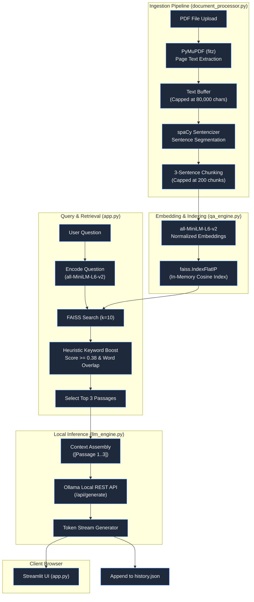
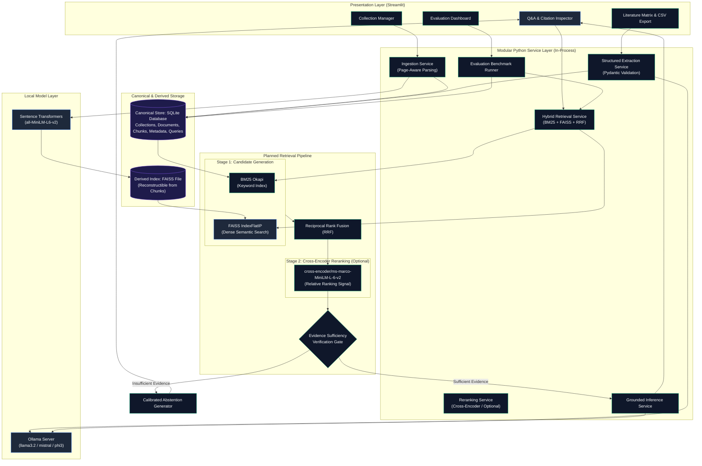
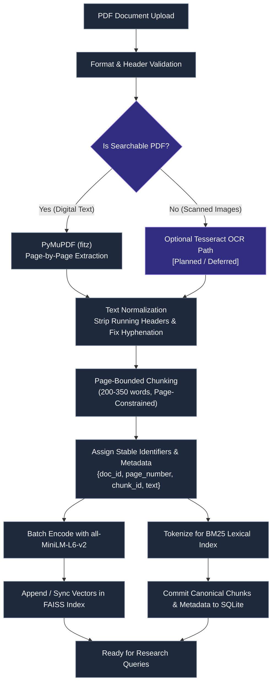
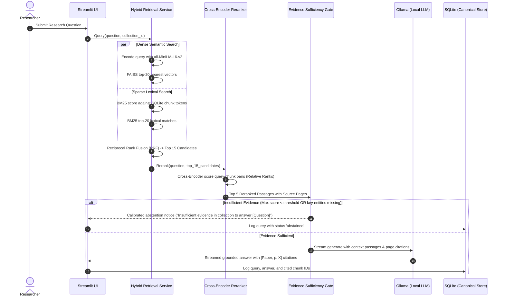
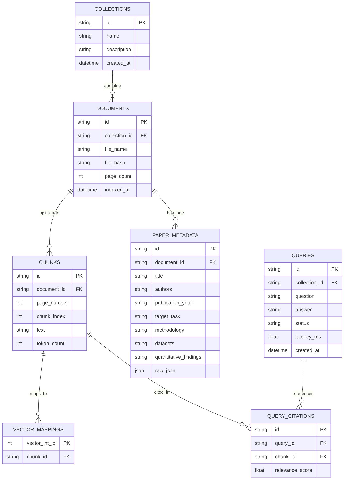

# IntelliAsk Research — System Architecture & Technical Design

This document details the software architecture, design decisions, index-lifecycle management, and system boundaries of **IntelliAsk Research**, contrasting the existing prototype implementation with the target V1 architecture.

---

## 1. Architectural Philosophy

IntelliAsk Research is engineered as a **general-purpose, local-first scientific literature analysis platform** that helps researchers analyze, synthesize, and compare scientific papers using traceable, evidence-grounded retrieval. The design adheres to three core tenets:

1. **Local-First Execution**: Ingestion, vector embedding, similarity search, and model inference run locally on user hardware via Ollama and local embedding models. Local processing eliminates the transmission of research manuscripts to external cloud APIs, though individual host environments still require standard operating system access controls.
2. **Deterministic Evidence Traceability & Calibrated Abstention**: Answers cite verified document source locations (paper and page level). If retrieved context is inadequate or ambiguous, the system is designed to abstain rather than synthesize speculative claims. Neither citation parsing nor sufficiency checks constitute a mathematical guarantee of factual accuracy; they are structured safeguards designed to reduce unsupported answers.
3. **Reproducible Evaluation**: Retrieval and generation pipelines are treated as empirical systems measured across standard quantitative information retrieval (IR) and grounding metrics on curated research corpora before claiming performance improvements.

---

## 2. Current Implementation Analysis

The existing codebase consists of an interactive Streamlit application (`app.py`) backed by three modular source files in `src/`.

### Component Inspection

| File | Implemented Functionality | Architectural Characteristics & Constraints |
| :--- | :--- | :--- |
| [`app.py`](file:///c:/Users/SHIVANGI/OneDrive/Documents/Desktop/Projects/Intelligent-Question-Answering-System/app.py) | UI presentation, session state, basic keyword-boosting heuristic, response streaming, JSON history | Single-page Streamlit app. Monolithic query block combining FAISS retrieval, threshold filtering (`SCORE_THRESHOLD = 0.38`), token matching heuristic, and Ollama streaming. |
| [`src/document_processor.py`](file:///c:/Users/SHIVANGI/OneDrive/Documents/Desktop/Projects/Intelligent-Question-Answering-System/src/document_processor.py) | `DocumentProcessor`, `Chunk`, `get_nlp()` | Uses PyMuPDF (`fitz`) to extract text across pages into a single string (`text += page.get_text()`). Truncates text at 80,000 characters. Splits sentences using spaCy's `sentencizer`. Creates 3-sentence sliding windows (capped at 200 chunks). **Page boundaries are discarded during extraction.** |
| [`src/qa_engine.py`](file:///c:/Users/SHIVANGI/OneDrive/Documents/Desktop/Projects/Intelligent-Question-Answering-System/src/qa_engine.py) | `QAEngine`, `get_embedding_model()` | Loads `sentence-transformers/all-MiniLM-L6-v2`. Computes L2-normalized embeddings. Constructs an in-memory `faiss.IndexFlatIP` (inner product = cosine similarity). Performs top-$k$ similarity queries. |
| [`src/llm_engine.py`](file:///c:/Users/SHIVANGI/OneDrive/Documents/Desktop/Projects/Intelligent-Question-Answering-System/src/llm_engine.py) | `generate_answer()` | Connects to local Ollama REST server (`http://localhost:11434/api/generate`). Formats top-3 retrieved passages into a structured prompt. Streams tokens via Python generator to Streamlit. |
| `history.json` | Persistent query history | Flat JSON array storing questions, generated answers, top passages, and similarity scores. Appended on every query. |

### Existing Prototype Data Flow Diagram

The diagram below reflects the **actual** flow implemented in the current repository:

---

## 3. Architecture Gaps & V1 Target State

To evolve IntelliAsk into a platform suitable for scientific research literature, several core technical limitations must be reconciled:

| Functional Area | Current Implementation Gap | Target V1 Architecture Solution |
| :--- | :--- | :--- |
| **Document Granularity** | Single text buffer without page retention; 80,000 character cutoff; arbitrary 200-chunk cap. | Page-aware chunking preserving `page_number` (or `page_start`/`page_end`), bounding metadata, and document ID without arbitrary truncation. |
| **Document Scope** | Single PDF in-memory index; uploading a new PDF overwrites state. | Multi-document project collections stored in persistent SQLite tables with derived FAISS vector indices. |
| **Retrieval Strategy** | Bi-encoder FAISS search + rudimentary word-match booster heuristic. | Two-stage hybrid retrieval: Sparse BM25 + Dense FAISS fused via Reciprocal Rank Fusion (RRF), followed by optional Cross-Encoder reranking. |
| **Citations & Grounding** | Passages presented with similarity scores; no page-level citations in LLM answer. | Prompt-enforced page citation syntax (`[Paper, p. X]`) validated against retrieved context chunks. |
| **Evidence Sufficiency** | Rudimentary fallback if score < 0.38; LLM may hallucinate on low-relevance context. | Explicit evidence sufficiency gate that triggers an abstention response when evidence is incomplete or missing. |
| **Structured Intelligence** | No structured paper metadata or synthesis across documents. | Pydantic-validated JSON extraction for literature matrices (objectives, methods, datasets, findings) with CSV export. |
| **Persistence & Lifecycle** | Flat `history.json` file; no deletion or vector synchronization. | Normalized SQLite database as canonical store; derived FAISS and BM25 indices synchronized or rebuilt on collection changes. |
| **Service Decoupling** | Monolithic query handling inside `app.py`. | Modular Python service packages (`src/ingestion/`, `src/retrieval/`, `src/synthesis/`, `src/storage/`) invoked directly by Streamlit without premature API microservices. |

---

## 4. Planned V1 Architecture

The target V1 system organizes functionality into modular Python services without requiring FastAPI as a prerequisite. Streamlit directly coordinates the services while SQLite serves as the canonical store of truth.

The domain-independent retrieval and answer flow is:
$$\text{PDF Ingestion} \rightarrow \text{Page-Aware Chunks} \rightarrow \text{Dense \& Lexical Retrieval} \rightarrow \text{Rank Fusion} \rightarrow \text{Optional Reranking} \rightarrow \text{Sufficiency Check} \rightarrow \text{Answer / Abstention}$$

---

## 5. Document Ingestion & Page-Aware Chunking Strategy

### Page-Bounded Chunks for V1
To guarantee that citations resolve to unambiguous physical pages, V1 enforces **page-bounded chunking**:
1. PyMuPDF extracts text page-by-page, retaining the 1-indexed physical PDF page number.
2. Text within each page is split into semantic paragraphs/sentences via spaCy.
3. Sliding chunk windows (typically 200–350 words with 30–50 word overlap) are constrained to remain within the boundaries of a single page:
   $$\text{Chunk}_{\text{id}} = \text{doc\_id} + \text{"\_p"} + \text{page\_num} + \text{"\_c"} + \text{chunk\_index}$$
4. If a single uninterrupted section spans across a page boundary, chunks record both `page_start` and `page_end` in chunk metadata.

---

## 6. Retrieval, Reranking & Evidence Assessment Sequence

### Understanding Cross-Encoder Scores
In the planned retrieval flow, candidates are generated by dense FAISS search and sparse BM25 search, merged via Reciprocal Rank Fusion (RRF), and then optionally reranked by a cross-encoder (`cross-encoder/ms-marco-MiniLM-L-6-v2`).
- **Nature of Scores**: Cross-encoder logits represent relative ranking discriminators between candidate passages for a given query. They are **not** calibrated posterior probabilities of factual truth, nor do they guarantee that the passage fully answers the research inquiry.
- **Sufficiency Gate**: The evidence sufficiency gate evaluates whether the top reranked chunks exceed a minimum relevance threshold and contain necessary query terms or entities. If this criteria fails, the system executes an explicit abstention path.

---

## 7. Storage Architecture & Index Lifecycle Management

### SQLite as the Canonical Store
In IntelliAsk Research V1, **SQLite is the sole canonical persistence layer**. All raw text, page numbers, extracted paper schemas, collection mappings, and query logs live in SQLite.
- **FAISS and BM25 are Derived Indexes**: The vector index and BM25 index are transient derived artifacts that can be fully rebuilt from the SQLite database at any time.

### Stable Identifiers & Vector Mapping
1. **Document Identifier**: A deterministic hash of document content or UUID (`doc_id`).
2. **Chunk Identifier**: `chunk_id = f"{doc_id}_p{page_number}_c{chunk_index}"`.
3. **Vector ID Mapping**: FAISS requires integer IDs. An integer mapping table `vector_mappings (vector_int_id INTEGER PRIMARY KEY, chunk_id TEXT UNIQUE)` in SQLite connects each vector in FAISS back to its canonical chunk record.

### Deletion and Re-Indexing Strategy (Avoiding Stale Vectors)
When a paper is deleted or updated in a collection:
- **Strategy A (Rebuild on Collection Modification)**: For typical research collections (5–10 papers, ~500–1,500 chunks), rebuilding the FAISS index and BM25 index directly from SQLite takes under 2 seconds. Rebuilding from canonical SQLite guarantees zero index drift, avoids orphaned vectors, and ensures index consistency.
- **Strategy B (Incremental Removal via IndexIDMap2)**: When using larger collections, `faiss.IndexIDMap2` supports explicit deletion of vector IDs using `index.remove_ids(np.array([vector_id]))`. SQLite deletes the corresponding chunk records and vector mappings in a single transaction.

---

## 8. Architectural Boundaries & Non-Goals

To maintain high research fidelity and execution discipline, the following boundaries are strictly enforced for V1:

- **Domain-Independent Architecture**: The ingestion, indexing, retrieval, and synthesis engines operate over general scientific PDF literature without hardcoded assumptions about specific research domains.
- **No Remote APIs as Hard Dependencies**: IntelliAsk V1 runs fully on local computational resources (CPU/GPU) with local models via Ollama.
- **No Premature Microservices or FastAPI**: All application logic runs as modular Python packages in the same process as the Streamlit application.
- **No Complex Autonomous Multi-Agent Loops**: All retrieval and comparison pipelines are deterministic, controlled state machines rather than open-ended autonomous agents.
- **Derived Indexes Reconstructible from SQLite**: Vector indices are never treated as the primary store of truth; they are always reconstructible from canonical SQLite tables.
