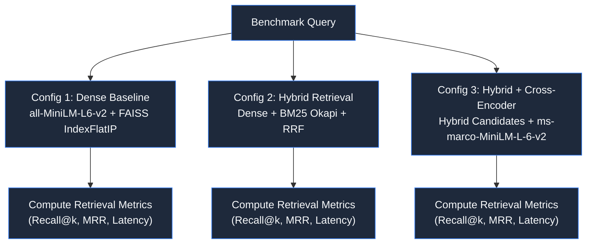

# IntelliAsk Research — Evaluation Methodology & Benchmark Framework

This document outlines the evaluation framework for **IntelliAsk Research**, detailing the benchmark dataset specification, experimental retrieval configurations, quantitative metrics, and research integrity protocols.

---

## 1. Evaluation Philosophy

In retrieval-augmented scientific question answering, claims of performance must be backed by quantifiable, reproducible benchmarks rather than qualitative impressions. IntelliAsk Research decouples **retrieval quality** from **answer generation quality** to isolate bottlenecks in document ranking versus LLM synthesis.

> [!IMPORTANT]
> **Implementation Status**: The evaluation framework defined here is planned and undergoing benchmark dataset curation as part of Week 1–3 milestones. No synthetic benchmark numbers, fabricated paper titles, or simulated percentage gains are reported. All experimental results in project documentation are marked as **Pending Execution**.

---

## 2. Benchmark Corpus & Query Dataset Design

The evaluation suite is designed to be **domain-neutral**, evaluated across a curated corpus of **approximately 5–10 carefully selected open-access scientific papers**. 

### Selection Principles
- **Evaluation Suitability**: Papers are chosen based on their ability to rigorously test retrieval accuracy, evidence grounding, and question answering—not because they belong to one predetermined application domain.
- **Manageable Corpus Scale**: A focused set of related papers (e.g., from machine learning, computer vision, or applied computational sciences) can form a coherent thematic core, while additional papers test cross-topic retrieval without introducing unmanageable annotation complexity.
- **Optional Domain Case Studies**: Specific applied research collections (such as automated road distress inspection, medical imaging preprints, or NLP tokenization literature) may serve as optional case studies for demonstration, but are not mandatory dependencies of the core benchmark framework.
- **Pending Curation Notice**: The actual papers and ground-truth annotations are queued for formal curation during the Week 1 milestone. No papers or annotations are claimed as complete in advance.

### Query Modalities
The benchmark targets **approximately 20–30 manually curated research questions** distributed across three inquiry modes:

1. **Specific Factoid Queries**: Precise architectural hyperparameters, reported evaluation scores, dataset split counts, or hardware training details.
2. **Methodological Synthesis Queries**: Comparing two algorithms, summarizing ablation findings, or explaining theoretical trade-offs across paragraphs.
3. **Negative / Unanswerable Queries (Abstention Tests)**: Questions that sound plausible within the subject context but are intentionally unanswerable from the provided paper text (e.g., asking for implementation details omitted from a preprint). These evaluate whether the system properly abstains or hallucinates unsupported facts.

### Benchmark Schema (JSON Specification)

Gold page references and verified evidence text spans serve as the primary ground-truth anchors, avoiding exclusive reliance on exact chunk-string matching because chunk boundaries may evolve during pre-processing development.

```json
{
  "$schema": "http://json-schema.org/draft-07/schema#",
  "title": "IntelliAskBenchmarkItem",
  "type": "object",
  "properties": {
    "id": { "type": "string" },
    "question": { "type": "string" },
    "query_type": { "enum": ["factoid", "synthesis", "abstention"] },
    "target_paper_ids": {
      "type": "array",
      "items": { "type": "string" }
    },
    "gold_pages": {
      "type": "array",
      "items": { "type": "integer" },
      "description": "1-indexed physical PDF page numbers containing necessary evidence."
    },
    "gold_evidence_spans": {
      "type": "array",
      "items": { "type": "string" },
      "description": "Key textual excerpts from the paper directly supporting the answer."
    },
    "key_facts": {
      "type": "array",
      "items": { "type": "string" }
    },
    "evidence_sufficient": {
      "type": "boolean",
      "description": "True if the question is answerable from the corpus; False for negative/abstention tests."
    },
    "reference_answer": { "type": "string" }
  },
  "required": ["id", "question", "query_type", "target_paper_ids", "gold_pages", "evidence_sufficient"]
}
```

### Illustrative Schema Record

> [!NOTE]
> **Illustrative Template**: The record below illustrates the schema format. Actual benchmark records will be populated from verified papers during the Week 1 milestone.

```json
{
  "id": "q-demo-001",
  "question": "What is the primary evaluation metric and reported score for the baseline model on the test split?",
  "query_type": "factoid",
  "target_paper_ids": ["sample_study_2024.pdf"],
  "gold_pages": [6],
  "gold_evidence_spans": [
    "On the primary test split, the baseline architecture achieved a mean Average Precision (mAP@0.5) of 68.2% across all evaluation categories."
  ],
  "key_facts": [
    "mAP@0.5 metric",
    "score of 68.2%"
  ],
  "evidence_sufficient": true,
  "reference_answer": "The baseline model achieves an mAP@0.5 score of 68.2% on the primary test split."
}
```

---

## 3. Retrieval Experiment Configurations

To determine the empirical benefits of multi-stage retrieval, three deterministic pipelines will be evaluated against identical benchmark queries and document splits:



### Configuration 1: Dense Semantic Baseline (Current Implementation)
- **Embedding Model**: `sentence-transformers/all-MiniLM-L6-v2` (384 dimensions).
- **Index**: FAISS `IndexFlatIP` (exact inner product on unit-normalized vectors).
- **Candidate Pool**: Top $k \in \{3, 5, 10\}$.

### Configuration 2: Hybrid Retrieval (Dense + BM25 Okapi)
- **Dense Candidate Retrieval**: Top 20 chunks from FAISS.
- **Sparse Candidate Retrieval**: Top 20 chunks from rank-bm25 index.
- **Fusion Method**: Reciprocal Rank Fusion (RRF):
  $$RRF\_Score(d) = \sum_{m \in \{dense, sparse\}} \frac{1}{60 + r_m(d)}$$
- **Candidate Pool**: Top 10 fused passages.

### Configuration 3: Hybrid Retrieval with Cross-Encoder Reranking
- **First Stage**: Top 15 candidates selected via RRF.
- **Second Stage**: Pairwise cross-encoder reranking via `cross-encoder/ms-marco-MiniLM-L-6-v2`.
- **Note on Cross-Encoder Scores**: Outputs are relative ranking discriminators across candidates; they are not calibrated probabilities of truth.
- **Final Selection**: Top 3–5 highest-scoring passages passed to the LLM prompt.

---

## 4. Quantitative Metrics

Metrics are strictly partitioned into **Retrieval Metrics** and **Answer Generation & Grounding Metrics**.

### A. Retrieval Metrics

| Metric | Target Calculation | Scientific Purpose |
| :--- | :--- | :--- |
| **Recall@k** ($k \in \{3, 5, 10\}$) | $\frac{|\text{Retrieved}_k \cap \text{GoldEvidence}|}{|\text{GoldEvidence}|}$ | Measures if the necessary gold evidence pages/spans are captured within the top-$k$ retrieved chunks. |
| **Precision@k** | $\frac{|\text{Retrieved}_k \cap \text{GoldEvidence}|}{k}$ | Measures relevance density and noise ratio in candidate sets. |
| **Mean Reciprocal Rank (MRR)** | $\frac{1}{|Q|} \sum_{i=1}^{|Q|} \frac{1}{\text{rank}_i}$ | Measures how high the first passage containing gold evidence appears in the ranked list. |
| **nDCG@k** | Normalized Discounted Cumulative Gain | Measures graded ranking quality when multiple relevant passages exist across pages. |
| **Retrieval Latency (ms)** | Mean and 95th percentile execution time | Measures runtime cost of vector search, BM25 scoring, and neural cross-encoder inference. |

### B. Answer Generation & Grounding Metrics

| Metric | Target Calculation | Scientific Purpose |
| :--- | :--- | :--- |
| **Citation Precision** | $\frac{|\text{CitedPages} \cap \text{GoldPages}|}{|\text{CitedPages}|}$ | Evaluates whether cited page numbers match verified gold evidence locations. |
| **Citation Recall** | $\frac{|\text{CitedPages} \cap \text{GoldPages}|}{|\text{GoldPages}|}$ | Evaluates whether all required supporting source pages were referenced. |
| **Answer Groundedness** | Ratio of verifiable claims supported by retrieved context | Detects ungrounded facts or hallucinations not present in provided context. |
| **End-to-End Latency** | Time to first token (TTFT) and total generation time (s) | Measures local inference responsiveness across supported Ollama models. |

### C. Balanced Abstention Evaluation
A common pathology in RAG systems with abstention gates is a trivial failure mode: a system that refuses to answer every query achieves 100% precision on unanswerable questions, while being entirely useless in practice.

To prevent rewarding over-abstention, abstention is evaluated across **both answerable and unanswerable questions**:

| Metric | Calculation | Purpose |
| :--- | :--- | :--- |
| **Abstention True Negative Rate (TNR)** | $\frac{\text{Correct Abstentions on Unanswerable Queries}}{\text{Total Unanswerable Queries}}$ | Measures ability to withhold answers when evidence is absent. |
| **False Abstention Rate (FAR)** | $\frac{\text{Incorrect Abstentions on Answerable Queries}}{\text{Total Answerable Queries}}$ | Penalizes the system for refusing to answer when valid evidence was provided. |
| **Abstention F1 Score** | Harmonic mean of Abstention Precision and Recall | Balanced measurement ensuring neither over-abstention nor reckless answering is rewarded. |

---

## 5. Automated Judge Protocol & Fallibility Disclosures

For scaling answer groundedness and claim verification across iterations, an automated LLM-as-a-judge prompt is utilized:

```text
You are an impartial scientific reviewer evaluating an AI-generated answer against retrieved evidence passages from scientific papers.

Question: {question}
Retrieved Passages: {context}
Candidate Answer: {answer}

For each claim in the Candidate Answer:
1. Identify if the claim is directly supported by the Retrieved Passages.
2. Label claim status: [SUPPORTED], [CONTRADICTED], or [UNSUPPORTED].
3. If unsupported, explain the gap.

Conclude with a final Groundedness Score between 0.0 and 1.0 (proportion of supported claims).
```

### Known Judge Failure Modes & Mitigations
1. **Verbosity Bias**: LLM judges systematically favor longer, verbose answers regardless of factual tightness.
   - *Mitigation*: Bounded reference answers and strict sentence-by-sentence claim decomposition.
2. **Self-Model Bias**: An LLM judge often rates outputs from its own model family higher.
   - *Mitigation*: Decouple generator model (e.g., Llama 3.2:1b) from judge models, and maintain a manually annotated test split.
3. **Mandatory Human Verification**: Automated judge scores are considered directional heuristics. The final V1 evaluation report will include 100% human-verified spot checking of all benchmark QA pairs.

---

## 6. Evaluation Reporting Template

All future experiment runs will be reported according to the following standardized layout:

```text
================================================================================
IntelliAsk Research — Retrieval Benchmark Summary (Pending Run)
Date: [YYYY-MM-DD] | Corpus: [N papers, M chunks] | Test Set: [K queries]
Host Environment: [CPU / GPU / RAM]
================================================================================
Configuration               Recall@3   Recall@5   MRR@10   Latency (p95)
--------------------------------------------------------------------------------
1. Dense Baseline (MiniLM)   [Pending]  [Pending]  [Pending]   [Pending]
2. Hybrid (BM25 + Dense)     [Pending]  [Pending]  [Pending]   [Pending]
3. Hybrid + Cross-Encoder    [Pending]  [Pending]  [Pending]   [Pending]
--------------------------------------------------------------------------------
Generation & Grounding:
Model: llama3.2 (3B)
Citation Precision: [Pending] | Abstention F1: [Pending] | Groundedness: [Pending]
False Abstention Rate (FAR): [Pending]
================================================================================
```
