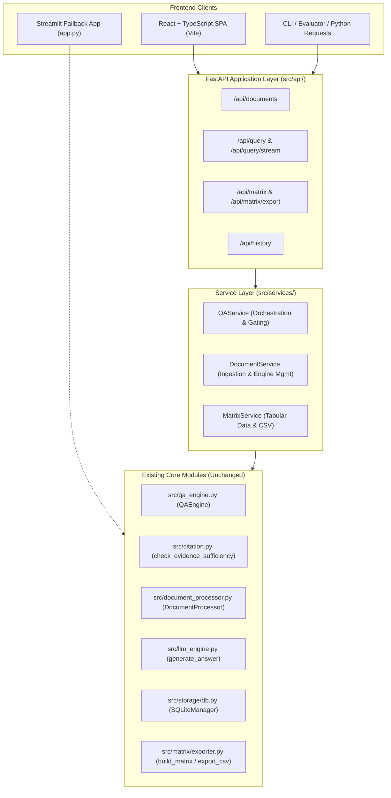
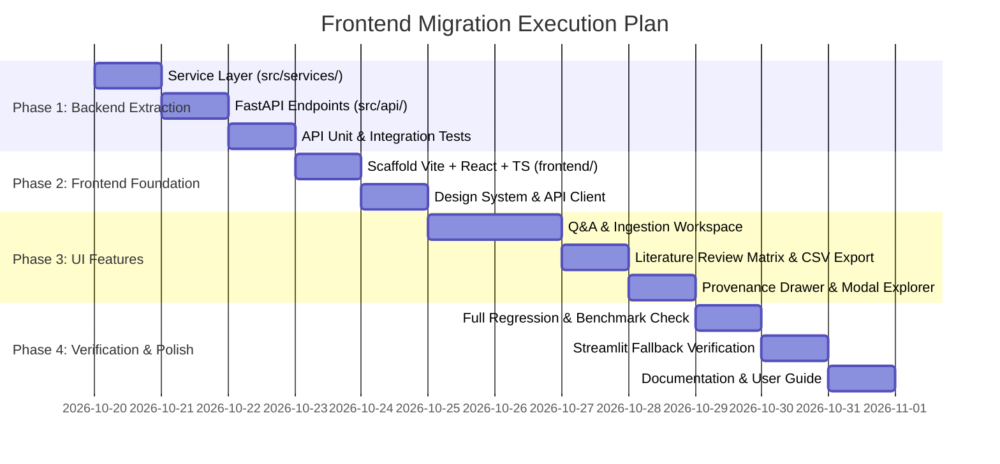

# IntelliAsk Research — Streamlit to React/FastAPI Frontend Migration Plan

**Document Version:** 1.0.0  
**Date:** October 19, 2026  
**Status:** Draft Plan for Review (Read-Only Planning Phase)  
**Target Milestone:** Frontend Architecture Modernization (Decoupling UI from Retrieval Core)  
**Baseline Test Status:** 249 tests passing, 0 failures (100% pass rate)

---

## 1. Executive Summary & Migration Motivation

### Current Architecture & Limitations
The current IntelliAsk application relies on Streamlit ([`app.py`](../app.py)), which couples:
1. **Application State**: `QAEngine` and uploaded document chunks are held in single-session in-memory state (`st.session_state.engine`).
2. **Business Logic & Orchestration**: Evidence sufficiency checking, dense score gating, best-chunk selection, and prompt formatting are embedded inside Streamlit event handlers.
3. **UI Rendering**: HTML/CSS generation and LLM token streaming (`st.write_stream`) run in the same script lifecycle as backend computation.
4. **Concurrency & Client Flexibility**: Streamlit does not expose headless REST/SSE endpoints for programmatic evaluation, multi-client access, or independent frontend updates.

### Migration Objectives
1. **Decouple the Backend into FastAPI**: Extract query orchestration, evidence gating, and document ingestion into clean, reusable service layers exposed via OpenAPI-compliant REST and Server-Sent Events (SSE) streaming endpoints.
2. **Build a High-Performance React Frontend**: Develop a state-of-the-art web application using **Vite + React + TypeScript**, offering instant client-side responsiveness, rich interactive tables (TanStack Table), real-time token streaming, and field-level provenance exploration.
3. **Preserve Streamlit as Fallback**: Maintain [`app.py`](../app.py) in working condition as an optional lightweight single-file interface.
4. **Zero Regressions in Core Research**: Guarantee that retrieval algorithms ([`src/qa_engine.py`](../src/qa_engine.py)), evidence sufficiency safeguards ([`src/citation.py`](../src/citation.py)), SQLite persistence ([`src/storage/db.py`](../src/storage/db.py)), and literature matrix transformation ([`src/matrix/exporter.py`](../src/matrix/exporter.py)) remain unaltered and 100% verified by all 249 existing tests.

---

## 2. Verified Repository Baseline

| Component | Status | Details |
| :--- | :--- | :--- |
| **Core Retrieval** (`src/qa_engine.py`) | Unchanged | Clean match with HEAD (`b3f38dc`), true cosine similarity, RRF, source-aware retrieval |
| **Citation & Gating** (`src/citation.py`) | Unchanged | Clean match with HEAD (`b3f38dc`), `math.isfinite()` validation, document scoping, entity validation |
| **Ingestion** (`src/document_processor.py`) | Unchanged | 1-indexed physical PDF page numbering, sentence overlap chunking, deterministic IDs |
| **LLM Engine** (`src/llm_engine.py`) | Unchanged | Recency bypass instructions, Ollama streaming generator |
| **Persistence** (`src/storage/db.py`) | Untracked (Phase 4.2) | SQLiteManager with foreign key cascades, idempotent upserts, schema versioning |
| **Extraction** (`src/extraction/`) | Untracked (Phase 4.1/4.3) | Pydantic schemas, LLM prompt generation, JSON markdown/trailing comma repair |
| **Literature Matrix** (`src/matrix/`) | Untracked (Phase 4.3) | 12-column table transformation, numeric page sorting, RFC 4180 CSV export |
| **Existing App** (`app.py`) | Modified | Literature matrix view + Ask Questions view integrated; compiles cleanly |
| **Dependencies** (`requirements.txt`) | Modified | Contains `pydantic` and `pandas` |
| **Test Suite** | Passing | 249 tests passing, 0 failures, 3 external SWIG warnings |
| **Benchmark Artifacts** (`reports/`) | Frozen | SHA-256 verified baseline and comparative benchmark reports & JSON outputs |

---

## 3. Backend Architecture & API Specifications (FastAPI)

### A. Architectural Decoupling Diagram



### B. Service Layer Extraction

To decouple business logic from Streamlit without modifying `app.py`, new lightweight service modules will be added in `src/services/`:

1. **`src/services/qa_service.py`**:
   - Encapsulates the exact query logic currently implemented in `app.py`:
     - Calls `engine.search_hybrid(query, k=10)`.
     - Runs `check_evidence_sufficiency(results, query, score_threshold=0.38, use_dense_score=True)`.
     - Filters `qualifying_chunks = [r for r in results if _is_qualifying_chunk(r, 0.38)]`.
     - Evaluates `has_supporting_evidence = not verdict.should_abstain and bool(qualifying_chunks)`.
     - Selects `best` chunk strictly from qualifying evidence.
     - Provides non-streaming and streaming generator output with structured metadata.
     - Saves queries and verified supporting evidence to SQLite or chat history.

2. **`src/services/document_service.py`**:
   - Manages uploaded PDFs: runs `DocumentProcessor.process_file()`.
   - Maintains indexed chunks and FAISS/BM25 engine state in an application-level `QAEngineManager`.
   - Registers documents in `SQLiteManager` (`register_document`).

3. **`src/services/matrix_service.py`**:
   - Interfaces directly with `src/matrix/exporter.py` (`build_matrix_from_db`, `export_db_to_csv`).

### C. Application Lifespan & State Management
- **Lifespan Manager**: Uses FastAPI's `@asynccontextmanager lifespan(app: FastAPI)` to load spaCy (`get_nlp()`) and sentence-transformers (`get_embedding_model()`) once at server startup.
- **Engine State**: Managed via a singleton `QAEngineManager` in `src/services/document_service.py`. On startup, if documents exist in `data/papers.db`, it can pre-load or lazily initialize the search index.

### D. REST & Streaming Endpoint Specifications

| Endpoint | Method | Input | Output | Purpose |
| :--- | :--- | :--- | :--- | :--- |
| `/api/health` | GET | None | `HealthResponse` | Liveness probe (instant, non-blocking) |
| `/api/readiness` | GET | None | `ReadinessResponse` | Subsystem readiness probe (API, DB, Ollama, model) |
| `/api/documents/upload` | POST | `multipart/form-data` (PDF file) | `DocumentUploadResponse` | Ingests PDF, chunks text, builds indices, records in SQLite |
| `/api/documents` | GET | None | `List[DocumentRecord]` | Lists all registered documents and metadata |
| `/api/documents/{id}/provenance` | GET | Path `id` | `List[FieldProvenanceResponse]` | Returns physical page badges and verbatim quotes |
| `/api/query` | POST | `QueryRequest(query, model)` | `QueryResponse` (JSON) | Non-streaming hybrid search with evidence gating |
| `/api/query/stream` | POST | `QueryRequest(query, model)` | `text/event-stream` (SSE) | Real-time token streaming with metadata headers |
| `/api/history` | GET | None | `List[HistoryEntry]` | Returns chat history |
| `/api/history` | DELETE | None | `{"cleared": true}` | Clears chat history |
| `/api/matrix` | GET | None | `List[Dict[str, Any]]` | Returns tabular literature review matrix |
| `/api/matrix/export` | GET | None | `text/csv` (File Attachment) | Downloads RFC 4180 CSV export |

#### Structured Query Response Schema (`QueryResponse`)
```json
{
  "query": "What is the LiDAR sensor model used?",
  "answer": "The sensor model used is the Ouster OS1-32...",
  "answer_source": "ollama",
  "has_supporting_evidence": true,
  "score": 0.512,
  "source": "karukayil.pdf",
  "citations": ["karukayil.pdf, p. 5"],
  "verdict": {
    "sufficient": true,
    "should_abstain": false,
    "confidence": 0.450,
    "reason": "4 passage(s) exceed relevance threshold...",
    "chunk_count": 10,
    "scoped_chunk_count": 10,
    "missing_entities": [],
    "missing_sources": []
  },
  "supporting_passages": [
    {
      "citation": "karukayil.pdf, p. 5",
      "score": 0.512,
      "text": "The Ouster OS1-32 LiDAR sensor was mounted on the vehicle..."
    }
  ],
  "all_retrieved": [
    {
      "rank": 1,
      "citation": "karukayil.pdf, p. 5",
      "score": 0.512,
      "text": "The Ouster OS1-32...",
      "qualifies": true
    }
  ]
}
```

---

## 4. Frontend Architecture & Design System (React + TypeScript)

### A. Technology Stack
- **Framework**: React 18 + Vite (TypeScript).
- **Styling**: Vanilla CSS / TailwindCSS with tailored CSS custom properties matching IntelliAsk's modern dark theme (`#080811`, `#0f0f1e`, `#1a1a2e`, `#7c3aed`, `#34d399`, `#fca5a5`).
- **Typography**: Google Fonts Inter / Outfit.
- **Icons**: Lucide React.
- **Table / Matrix**: TanStack Table (v8) for responsive, sortable, multi-column scientific matrix display.
- **Markdown & Streaming**: `react-markdown` + `remark-gfm` for scientific formatting and formulas.

### B. UI Component Hierarchy

```text
src/
├── components/
│   ├── layout/
│   │   ├── AppHeader.tsx            # Branding, model status badge, local execution indicator
│   │   ├── NavigationTabs.tsx       # Switch between "Ask Questions" & "Literature Matrix"
│   │   └── Sidebar.tsx              # Model selector (Ollama), quick status, clear history
│   ├── qa/
│   │   ├── DocumentUploader.tsx     # Drag-and-drop PDF dropzone, upload progress, page counter
│   │   ├── QuestionInput.tsx        # Search bar, query suggestions, clear button
│   │   ├── AnswerCard.tsx           # Streaming token renderer, model badge, copy button
│   │   ├── AbstentionCard.tsx       # Styled abstention banner with reason and missing entity tags
│   │   ├── EvidenceMetaPills.tsx    # Relevance score, source paper pill, citation badges
│   │   ├── SupportingPassages.tsx   # Verified passages list with page numbers & scores
│   │   ├── SourceNavigation.tsx     # Expandable drawer of all 10 raw RRF candidates
│   │   └── ChatHistory.tsx          # Collapsible history cards with timestamp & clear button
│   └── matrix/
│       ├── MatrixTable.tsx          # TanStack Table with 12 deterministic columns, sorting, filtering
│       ├── EmptyMatrixState.tsx     # Distinct banners for 0 docs vs registered-unextracted docs
│       ├── CsvDownloadButton.tsx    # Triggers /api/matrix/export with download spinner
│       └── ProvenanceModal.tsx      # Field-by-field explorer with verbatim quotes & physical pages
├── services/
│   ├── api.ts                       # Fetch / Axios HTTP client with typed responses
│   └── sse.ts                       # Server-Sent Events stream consumer
├── types/
│   └── index.ts                     # TypeScript interfaces matching backend Pydantic schemas
└── App.tsx                          # Root state, active tab routing, notifications
```

---

## 5. Phased Implementation Strategy & Verification Gates



### Phase 1: Backend Service Extraction & FastAPI Implementation
- Create `src/services/qa_service.py`, `src/services/document_service.py`, `src/services/matrix_service.py`.
- Create `src/api/` containing FastAPI routes and lifespan startup.
- Add FastAPI dependencies (`fastapi`, `uvicorn`, `python-multipart`, `sse-starlette`) to `requirements.txt`.
- Add comprehensive API integration tests in `tests/test_api_*.py` using `fastapi.testclient.TestClient`.
- **Gate 1**: All 249 existing tests + new API tests must pass (100% pass rate).

### Phase 2: Frontend Foundation & Design System
- Initialize `frontend/` directory using Vite React TypeScript template.
- Implement design tokens, typography, layout components, and TypeScript API types.
- Implement `api.ts` and `sse.ts` for HTTP requests and token streaming.
- **Gate 2**: Frontend builds cleanly (`npm run build`) with zero TypeScript errors.

### Phase 3: React Feature Implementation
- **Sprint 3A**: Ingestion & Question-Answering Workspace (document dropzone, streaming AI answer card, evidence pills, verified supporting passages, raw candidate drawer, chat history).
- **Sprint 3B**: Literature Review Matrix (12-column TanStack table, column visibility toggles, CSV download, field provenance modal).
- **Gate 3**: Manual and automated mock testing of all user flows.

### Phase 4: Final Verification, Fallback Audit & Documentation
- Execute full backend test suite (`python -m pytest`).
- Verify `streamlit run app.py` continues to execute independently with identical fallback behavior.
- Confirm baseline benchmark files (`reports/baseline_benchmark_*`) and Week 3 artifacts remain unchanged.
- Document deployment and development startup commands (`uvicorn src.api.main:app` + `npm run dev`).

---

## 6. Strict Preservation Checklist & Boundary Rules

- [ ] **Do Not Modify Core Retrieval**: Preserve [`src/qa_engine.py`](../src/qa_engine.py) (FAISS cosine similarity, BM25Okapi, RRF, source-aware retrieval).
- [ ] **Do Not Modify Evidence Gating**: Preserve [`src/citation.py`](../src/citation.py) (`math.isfinite()` validation, document scoping, critical entity matching, required-source coverage).
- [ ] **Do Not Alter Provenance Tracking**: Preserve 1-indexed physical PDF page numbering in `Chunk.page_number` and `ProvenanceSpan.page_number`.
- [ ] **Preserve Streamlit Application**: Keep [`app.py`](../app.py) working as the local fallback.
- [ ] **Preserve SQLite Schema**: Keep `src/storage/db.py` schema version 1 with foreign-key cascades and idempotent ingestion.
- [ ] **Preserve Benchmark Integrity**: All files in `reports/`, `data/papers/`, and `data/corpus_manifest.json` must remain pristine.
- [ ] **No Batch Ingestion During Migration**: Do not trigger automated LLM extraction across the 7-paper corpus until explicitly commanded.
- [ ] **Zero Unverified Assertions**: All tests must be executed and reported with exact commands and output logs.

---

*(Plan complete. Awaiting user authorization to proceed.)*
