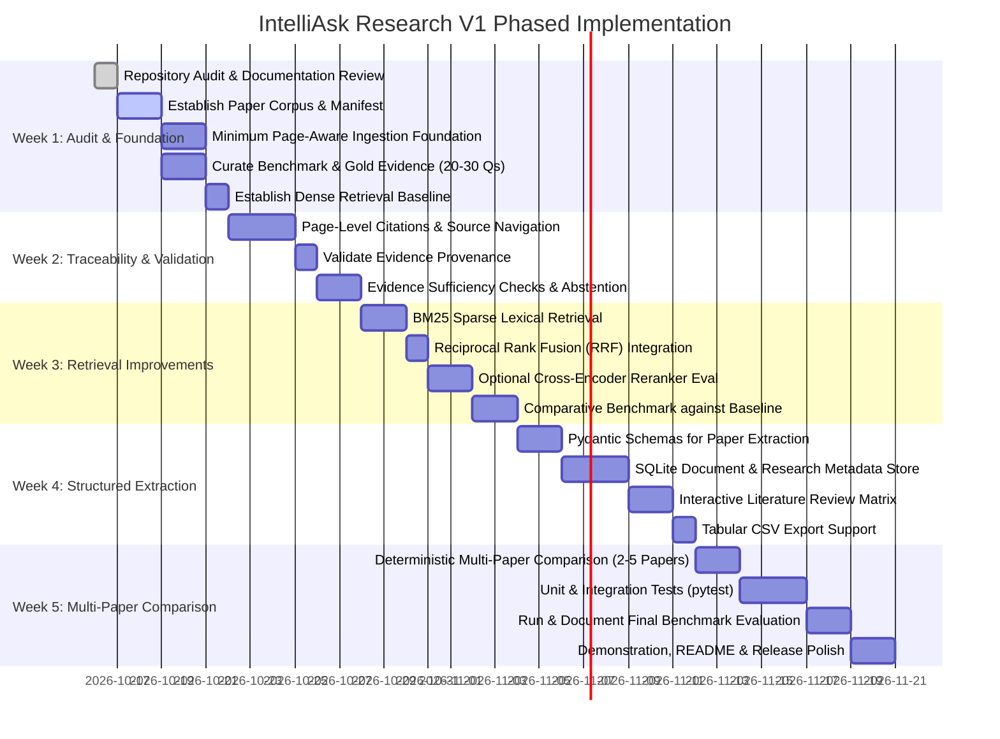

# IntelliAsk Research — Development Roadmap & Implementation Plan

This document outlines the phased development roadmap for **IntelliAsk Research**, detailing the 5-week milestone schedule for V1 and cataloging explicitly deferred capabilities.

---

## 1. Roadmap Principles

1. **Target Plan, Not Claims of Completion**: Items listed across milestones reflect prioritized development targets. Only features confirmed in the repository audit are marked as implemented or complete.
2. **Evaluation-Grounded Milestones**: Every architectural enhancement (such as adding BM25 or Cross-Encoder rerankers) must be evaluated against the curated benchmark before claiming improvements.
3. **Domain-Neutral Foundation**: V1 is engineered as a general-purpose scientific literature platform evaluated across a manageable corpus of approximately 5–10 papers. Specialized application domains (e.g., pavement distress inspection or specific preprints) remain optional illustrative case studies, not mandatory architectural prerequisites.
4. **No Premature Complexity**: Focus exclusively on deterministic retrieval, page-level provenance, and grounded synthesis before considering complex agentic workflows.

---

## 2. 5-Week Target Plan (V1 Release)

### Detailed Milestone Breakdown

#### Week 1 — Repository Audit and Evaluation Foundation
- **Status**: Audit and documentation review complete; corpus setup, page-aware ingestion, and baseline tooling planned.
- **Objectives**:
  - Audit the current implementation and document known architectural limitations (`done`).
  - Establish the initial paper corpus manifest (approximately 5–10 carefully selected open-access papers) (`planned`).
  - Implement the minimum page-aware ingestion foundation to preserve physical PDF page numbers (`planned`).
  - Define the benchmark schema and curate the initial 20–30 questions with gold evidence (page numbers and supporting passages) (`planned`).
  - Establish the dense-retrieval baseline (`all-MiniLM-L6-v2` + FAISS `IndexFlatIP`) once benchmark data is available (`planned`).
- **Deliverables**: Verified repository audit log, paper manifest, benchmark JSON dataset, page-preserving chunking prototype, and baseline retrieval metrics log.

#### Week 2 — Evidence Traceability and Answer Validation
- **Status**: Planned for V1.
- **Objectives**:
  - Implement page-level citations (`[Paper, p. X]`) and interactive source navigation.
  - Validate evidence provenance between retrieved chunks and cited pages.
  - Introduce evidence sufficiency checks and calibrated abstention behavior when relevant evidence is absent.
  - Evaluate system behavior on both answerable and unanswerable benchmark questions.
- **Deliverables**: Page citation metadata in chunks, grounded citation prompt template, calibrated abstention handler in `app.py`, and provenance validation tests.

#### Week 3 — Retrieval Improvements
- **Status**: Planned for V1.
- **Objectives**:
  - Add BM25 lexical retrieval (`rank-bm25`) for keyword precision.
  - Combine dense FAISS vectors and lexical BM25 results using Reciprocal Rank Fusion (RRF).
  - Evaluate an optional cross-encoder reranker (`cross-encoder/ms-marco-MiniLM-L-6-v2`) over top fused candidates ($k=15$).
  - Compare retrieval quality (Recall@k, MRR, nDCG) and latency against the Week 1 baseline using the same benchmark.
- **Deliverables**: Modular hybrid retrieval service and comparative benchmark evaluation report.

#### Week 4 — Structured Research Extraction
- **Status**: Planned for V1.
- **Objectives**:
  - Implement validated structured extraction using Pydantic schemas (e.g., target problem, proposed methodology, datasets, quantitative findings, and limitations).
  - Add SQLite persistence as the canonical document, chunk, and research metadata store.
  - Build an interactive literature comparison matrix in Streamlit.
  - Support one-click CSV export of extracted literature matrices.
- **Deliverables**: Pydantic extraction models, SQLite database manager, interactive literature matrix UI, and CSV export functionality.

#### Week 5 — Multi-Paper Comparison and Release Preparation
- **Status**: Planned for V1.
- **Objectives**:
  - Implement deterministic multi-paper comparison across approximately 2–5 selected papers on a common research topic.
  - Add unit and integration tests (`pytest`) covering ingestion, retrieval, provenance, index lifecycle, and multi-paper comparison.
  - Run and document the final benchmark evaluation across all retrieval configurations.
  - Prepare the release demonstration, final README polish, limitations review, and post-V1 roadmap.
- **Deliverables**: Full test suite, verified evaluation results summary, index lifecycle tests, and updated demo walkthrough.

---

## 3. Explicitly Deferred Capabilities (Post-V1 Scope)

To maintain focus and avoid scope creep, the following features are **explicitly outside the V1 scope**:

| Feature Category | Description | Rationale for Deferral |
| :--- | :--- | :--- |
| **Online Paper Discovery** | Automated scraping or API integration with arXiv, Semantic Scholar, or CrossRef. | Introduces external API rate limits, schema variability, and internet dependency; conflicts with local-first focus. |
| **React / TypeScript Rewrite** | Replacing Streamlit with a standalone single-page application (SPA). | Streamlit provides rapid iteration and sufficient UI fidelity for V1; UI decoupling is premature before retrieval APIs stabilize. |
| **Autonomous Multi-Agent Systems** | Complex autonomous multi-agent loops (e.g., LangGraph or AutoGen agent debates). | Non-deterministic, high token consumption on small local models, and difficult to evaluate rigorously compared to controlled pipelines. |
| **Writing & Paper Drafting Assistant** | Tools for generating manuscript sections or drafting scientific prose. | Shifts product focus from objective literature analysis to generative content creation. |
| **Code & Experiment Execution** | Sandbox environments to run code snippets or reproduce ML experiments found in papers. | Introduces significant security, sandboxing, and compute overhead outside core IR scope. |
| **Multi-User Authentication & Cloud Storage** | User accounts, team sharing, and remote vector databases (e.g., Milvus, Pinecone). | Conflicts with single-user, local-first, privacy-preserving research design. |
