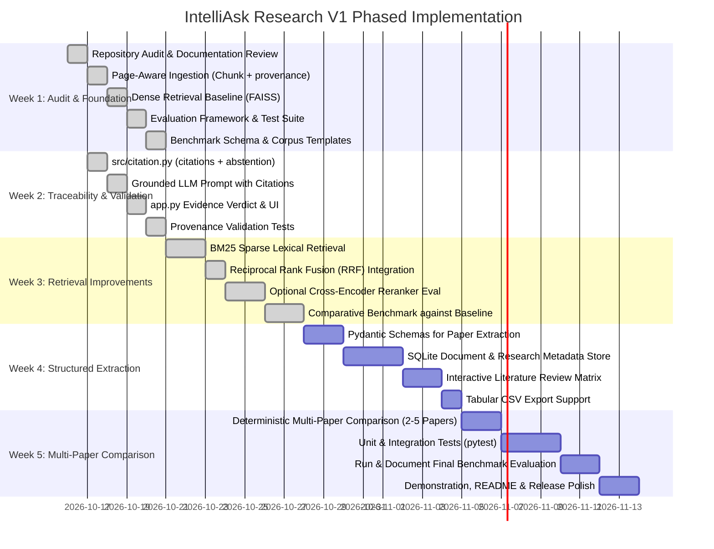

# IntelliAsk Research — Development Roadmap & Implementation Plan

This document outlines the phased development roadmap for **IntelliAsk Research**, detailing the 5-week milestone schedule for V1 and cataloging explicitly deferred capabilities.

---

## 1. Roadmap Principles

1. **Target Plan, Not Claims of Completion**: Items listed across milestones reflect prioritized development targets. Only features confirmed in the repository audit are marked as implemented or complete.
2. **Evaluation-Grounded Milestones**: Every architectural enhancement (such as adding BM25 or Cross-Encoder rerankers) must be evaluated against the curated benchmark before claiming improvements.
3. **Domain-Neutral Foundation**: V1 is engineered as a general-purpose scientific literature platform evaluated across a manageable corpus of approximately 5–10 papers. Specialized application domains (e.g., pavement distress inspection or specific preprints) remain optional illustrative case studies, not mandatory architectural prerequisites.
4. **No Premature Complexity**: Focus exclusively on deterministic retrieval, page-level provenance, and grounded synthesis before considering complex agentic workflows.

---

## 2. 5-Week Target Plan (V1 Release)

### Detailed Milestone Breakdown

#### Week 1 — Repository Audit and Evaluation Foundation
- **Status**: ✅ Complete (commit `f05ca60`).
- **Delivered**:
  - `src/document_processor.py` — `Chunk` class with 1-based page provenance, sentence-overlap chunking, and deterministic `document_id` hashing.
  - `src/qa_engine.py` — `QAEngine` with FAISS `IndexFlatIP` (cosine similarity via L2-normalised embeddings), bounded k-search, and `chunk.score` population.
  - `evaluation/` — `DenseRetrievalEvaluator`, `metrics.py` (Recall@k, Precision@k, MRR, nDCG@k, latency stats), `run_evaluation.py` CLI runner.
  - `tests/` — 13 unit tests covering ingestion, retrieval provenance, evaluator integration, and metrics correctness.
  - `data/` — `benchmark_questions_template.json` (schema + 2 illustrative QA pairs) and `corpus_manifest_template.json`.

#### Week 2 — Evidence Traceability and Answer Validation
- **Status**: ✅ Complete (commit `4b5dc2b`).
- **Delivered**:
  - `src/citation.py` — `format_citation()` / `format_citations()` producing `[Filename, p. X]` strings; `build_grounded_context()` for citation-prefixed LLM context; `EvidenceVerdict` dataclass; `check_evidence_sufficiency()` (score-threshold + keyword-overlap policy); `build_abstention_message()` for structured refusal.
  - `src/llm_engine.py` — Updated prompt injects grounded citations; instructs model to reference `[source, p. X]` per claim; anti-hallucination guard when context is insufficient.
  - `app.py` — Evidence verdict routing: abstention path shows styled amber warning card; confident path generates LLM answer with green citation pills; source navigation expander shows all 10 retrieved passages with rank, citation, and score.
  - `tests/test_citation.py` — 14 unit tests across all citation module functions.
  - `tests/test_provenance.py` — 8 end-to-end tests tracing page provenance from ingestion through retrieval into citation formatting.

#### Week 3 — Retrieval Improvements
- **Status**: ✅ Complete (validated via comparative benchmark report `reports/week3_comparative_benchmark_report.md`).
- **Delivered**:
  - `src/lexical_retriever.py` — Standalone BM25 lexical retriever (`rank-bm25` / BM25Okapi) with corpus tokenization and score normalization.
  - `src/qa_engine.py` — Reciprocal Rank Fusion (`search_hybrid`), dense cosine score preservation for lexical chunks via embedding dot-product, and source-aware candidate retrieval (`search_source_aware`).
  - `src/citation.py` — Dual-score gating, document scoping, required source coverage, and cross-chunk entity validation.
  - `app.py` — Production evidence-gate integration routing user queries through hybrid retrieval with defensive score extraction, recency bypass prompt instructions, and authoritative abstention handling.
  - `reports/week3_comparative_benchmark_report.md` — 18-question comparative evaluation report demonstrating 100.0% Document Recall@10, 86.7% Supporting Page Recall@10, 100.0% correct abstention on negative queries, and documented evaluation of cross-encoder reranker deferral.

#### Week 4 — Structured Research Extraction
- **Status**: Planned for V1.
- **Objectives**:
  - Implement validated structured extraction using Pydantic schemas (e.g., target problem, proposed methodology, datasets, quantitative findings, and limitations).
  - Add SQLite persistence as the canonical document, chunk, and research metadata store.
  - Build an interactive literature comparison matrix in Streamlit.
  - Support one-click CSV export of extracted literature matrices.
- **Deliverables**: Pydantic extraction models, SQLite database manager, interactive literature matrix UI, and CSV export functionality.

#### Week 5 — Multi-Paper Comparison and Release Preparation
- **Status**: Planned for V1.
- **Objectives**:
  - Implement deterministic multi-paper comparison across approximately 2–5 selected papers on a common research topic.
  - Add unit and integration tests (`pytest`) covering ingestion, retrieval, provenance, index lifecycle, and multi-paper comparison.
  - Run and document the final benchmark evaluation across all retrieval configurations.
  - Prepare the release demonstration, final README polish, limitations review, and post-V1 roadmap.
- **Deliverables**: Full test suite, verified evaluation results summary, index lifecycle tests, and updated demo walkthrough.

---

## 3. Explicitly Deferred Capabilities (Post-V1 Scope)

To maintain focus and avoid scope creep, the following features are **explicitly outside the V1 scope**:

| Feature Category | Description | Rationale for Deferral |
| :--- | :--- | :--- |
| **Online Paper Discovery** | Automated scraping or API integration with arXiv, Semantic Scholar, or CrossRef. | Introduces external API rate limits, schema variability, and internet dependency; conflicts with local-first focus. |
| **React / TypeScript Rewrite** | Replacing Streamlit with a standalone single-page application (SPA). | Streamlit provides rapid iteration and sufficient UI fidelity for V1; UI decoupling is premature before retrieval APIs stabilize. |
| **Autonomous Multi-Agent Systems** | Complex autonomous multi-agent loops (e.g., LangGraph or AutoGen agent debates). | Non-deterministic, high token consumption on small local models, and difficult to evaluate rigorously compared to controlled pipelines. |
| **Writing & Paper Drafting Assistant** | Tools for generating manuscript sections or drafting scientific prose. | Shifts product focus from objective literature analysis to generative content creation. |
| **Code & Experiment Execution** | Sandbox environments to run code snippets or reproduce ML experiments found in papers. | Introduces significant security, sandboxing, and compute overhead outside core IR scope. |
| **Multi-User Authentication & Cloud Storage** | User accounts, team sharing, and remote vector databases (e.g., Milvus, Pinecone). | Conflicts with single-user, local-first, privacy-preserving research design. |
