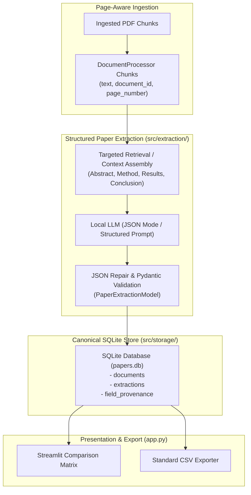

# IntelliAsk Research — Week 4 Implementation Plan: Structured Extraction & Persistence

**Document Version:** 1.0.0  
**Status:** Approved for Implementation (Planning Complete)  
**Target Milestone:** Week 4 — Structured Research Extraction & SQLite Persistence  
**Prerequisites:** Week 3 Hybrid Retrieval, Provenance & Evidence Gating Complete (142 tests passing)

---

## 1. Overview & Architectural Goals

The goal of Week 4 is to transition IntelliAsk Research from single-query, unstructured retrieval into a structured literature analysis platform. In scientific research workflows, researchers routinely synthesize collections of papers into structured comparative summaries (literature matrices) tracking research objectives, methodologies, benchmarks, datasets, quantitative findings, and acknowledged limitations.

To preserve scientific rigor, Week 4 implements:
1. **Pydantic Schemas for Structured Paper Extraction**: Strictly validated schemas capturing core research attributes with explicit page provenance per extracted field, separating explicitly grounded facts from unknown or unstated fields.
2. **Canonical SQLite Persistence**: A normalized, migration-safe SQLite relational store that persists indexed documents, extracted structured claims, and page provenance alongside the vector/lexical indices.
3. **Interactive Literature Review Matrix & Tabular CSV Export**: A structured tabular representation rendered in Streamlit allowing side-by-side comparison of multiple ingested papers, backed by deterministic CSV export.
4. **Resilient JSON Generation & Output Repair**: Safe extraction pipelines handling local LLM output quirks (Markdown codeblocks, trailing commas, missing keys) with fallback validation.



---

## 2. Component Design & Specifications

### Component A: Pydantic Schemas for Structured Paper Extraction (`src/extraction/schemas.py`)

Scientific papers often omit specific variables (e.g., an ablation study may not report hardware specifications or a preprint may omit formal limitation sections). Schemas must explicitly distinguish between **proven fact**, **missing/unstated information**, and **unsupported claims**, while preserving page-level traceability.

#### Schema Definition
```python
from typing import List, Optional
from pydantic import BaseModel, Field, HttpUrl

class ProvenanceSpan(BaseModel):
    """Pinpoints physical PDF page and verbatim quote supporting an extracted claim."""
    page_number: int = Field(..., ge=1, description="1-indexed physical PDF page number")
    verbatim_quote: Optional[str] = Field(None, description="Exact or normalized sentence from text supporting this extraction")

class ExtractedField(BaseModel):
    """Generic structured field with confidence and page provenance."""
    value: Optional[str] = Field(None, description="Extracted claim or 'Not reported'")
    is_stated: bool = Field(True, description="False if explicitly absent or not discussed in the paper")
    provenance: List[ProvenanceSpan] = Field(default_factory=list, description="Pages supporting this field")
    confidence: float = Field(default=1.0, ge=0.0, le=1.0, description="Extraction confidence")

class MetricResult(BaseModel):
    """Quantitative performance metric reported in paper."""
    metric_name: str = Field(..., description="Name of metric, e.g. mAP@0.5, F1-score, RMSE")
    value: str = Field(..., description="Numeric value or percentage as reported")
    dataset: Optional[str] = Field(None, description="Dataset or split on which metric was measured")
    provenance: Optional[ProvenanceSpan] = None

class PaperExtraction(BaseModel):
    """Canonical structured extraction record for a single scientific paper."""
    paper_id: str = Field(..., description="Unique paper identifier, e.g. document_id or filename")
    title: ExtractedField = Field(..., description="Canonical paper title")
    authors: ExtractedField = Field(default_factory=ExtractedField, description="List of authors or first author et al.")
    year: ExtractedField = Field(default_factory=ExtractedField, description="Publication or preprint year")
    research_objective: ExtractedField = Field(..., description="Primary research question, problem statement, or goal")
    proposed_methodology: ExtractedField = Field(..., description="Architectural design, algorithmic framework, or experimental method")
    dataset_used: ExtractedField = Field(default_factory=ExtractedField, description="Benchmark dataset(s) or custom data collection")
    hardware_or_sensors: ExtractedField = Field(default_factory=ExtractedField, description="Cameras, LiDAR, compute hardware, or optical devices")
    quantitative_findings: List[MetricResult] = Field(default_factory=list, description="Extracted quantitative results")
    acknowledged_limitations: ExtractedField = Field(default_factory=ExtractedField, description="Limitations stated by authors")
    extraction_timestamp: str = Field(..., description="ISO 8601 UTC timestamp of extraction")
```

#### Output Validation & Handling Malformed Model Responses
- **Extraction Helper**: `src/extraction/extractor.py` provides `extract_paper_structure(engine, document_id) -> PaperExtraction`.
- **Targeted Context Slicing**: Rather than feeding an entire 15-page document at once into a small local context window, targeted retrieval queries slice chunks for:
  - Header / Introduction (Title, Authors, Year, Objective)
  - Method Section (Proposed Methodology, Hardware/Sensors)
  - Experiments / Results (Dataset, Quantitative Metrics)
  - Discussion / Conclusion (Limitations)
- **JSON Repair Pipeline**: Local models may wrap JSON in triple backticks (````json ... ````), omit closing braces, or emit unescaped newlines. A robust pre-parser strips markdown formatting, cleans trailing commas via regex, and attempts `json.loads` before passing data into `PaperExtraction.model_validate()`. If parsing fails, it safely falls back to a populated schema where `is_stated=False` with error flags, preventing runtime app crashes.

---

### Component B: Canonical SQLite Persistence (`src/storage/db.py`)

A relational database provides immediate transactional consistency, multi-session state preservation, and zero external infrastructure dependencies.

#### SQLite Relational Schema
The database (`data/papers.db`) consists of three normalized tables:

```sql
-- 1. Ingested Documents
CREATE TABLE IF NOT EXISTS documents (
    document_id TEXT PRIMARY KEY,
    filename TEXT NOT NULL UNIQUE,
    page_count INTEGER NOT NULL,
    chunk_count INTEGER NOT NULL,
    char_count INTEGER NOT NULL,
    ingestion_timestamp TEXT NOT NULL
);

-- 2. Structured Paper Extractions
CREATE TABLE IF NOT EXISTS paper_extractions (
    extraction_id TEXT PRIMARY KEY,
    document_id TEXT NOT NULL UNIQUE REFERENCES documents(document_id) ON DELETE CASCADE,
    title TEXT NOT NULL,
    authors TEXT,
    year TEXT,
    research_objective TEXT,
    methodology TEXT,
    dataset TEXT,
    hardware_sensors TEXT,
    limitations TEXT,
    raw_json TEXT NOT NULL,
    extracted_at TEXT NOT NULL
);

-- 3. Granular Field Provenance & Metrics
CREATE TABLE IF NOT EXISTS extraction_metrics (
    metric_id INTEGER PRIMARY KEY AUTOINCREMENT,
    document_id TEXT NOT NULL REFERENCES documents(document_id) ON DELETE CASCADE,
    metric_name TEXT NOT NULL,
    metric_value TEXT NOT NULL,
    dataset TEXT,
    page_number INTEGER
);

CREATE TABLE IF NOT EXISTS field_provenance (
    id INTEGER PRIMARY KEY AUTOINCREMENT,
    document_id TEXT NOT NULL REFERENCES documents(document_id) ON DELETE CASCADE,
    field_name TEXT NOT NULL,
    page_number INTEGER NOT NULL,
    verbatim_quote TEXT
);

CREATE INDEX IF NOT EXISTS idx_doc_provenance ON field_provenance(document_id, field_name);
```

#### Key Design Decisions:
- **Traceability Guarantee**: Every claim stored in `paper_extractions` maps to one or more rows in `field_provenance` linking directly to physical PDF page numbers.
- **Repeat Ingestion Idempotency**: `INSERT INTO documents ... ON CONFLICT(document_id) DO UPDATE` ensures re-ingesting a document refreshes chunks and extractions without schema violations or duplicate records.
- **Relational Integrity**: Foreign keys with `ON DELETE CASCADE` guarantee that deleting a document cleans up its extractions, provenance, and metric records automatically.

---

### Component C: Literature Review Matrix & CSV Export (`src/matrix/`)

#### Tabular Representation
The matrix maps heterogeneous scientific extractions into a stable 2D tabular format suitable for display in `st.dataframe()` and standard spreadsheets.

| Field Name | Description | Representation when Missing |
| :--- | :--- | :--- |
| **Document** | Filename of PDF | `filename.pdf` |
| **Title** | Paper Title | Extracted string or `"Untitled / Unstated"` |
| **Year** | Year published | `"2025"` or `"Unstated"` |
| **Objective** | Core research goal | 1–2 sentence summary |
| **Methodology** | Proposed algorithm / architecture | Method name + brief details |
| **Dataset** | Evaluated dataset(s) | Dataset names or `"Custom / Not specified"` |
| **Key Metrics** | Semicolon-separated metrics | e.g. `"mAP@0.5: 68.2%; F1: 0.84"` |
| **Hardware / Sensors** | Devices, cameras, or LiDAR | Sensor model or `"Not reported"` |
| **Limitations** | Acknowledged shortcomings | Stated limitations or `"None acknowledged"` |
| **Pages Cited** | Unique pages cited in extraction | e.g. `"pp. 1, 3, 7, 9"` |

#### CSV Exporter (`src/matrix/exporter.py`)
- Provides `export_matrix_to_csv(extractions: List[PaperExtraction]) -> str` generating RFC 4180 compliant CSV strings.
- Handles empty data sets gracefully (returns header row only).
- Quotes multiline fields, commas, and double quotes cleanly.
- Preserves explicit provenance in a dedicated `Cited Pages` column.

---

### Component D: Streamlit UI Integration (`app.py`)

A new navigation tab / view in the existing single-page Streamlit application:
1. **"Ask Questions" (Existing)**: Hybrid retrieval Q&A with evidence sufficiency gating and grounded citations.
2. **"Literature Review Matrix" (New)**:
   - Displays interactive `st.dataframe()` of all extracted papers in the active database.
   - Allows users to select specific columns to compare (e.g. comparing only Methodology and Datasets).
   - "Extract Current Paper" button that triggers `extract_paper_structure()` on the currently uploaded PDF and saves to SQLite.
   - "Download Literature Matrix (CSV)" button using Streamlit's `st.download_button()`.
   - Expandable card per paper showing detailed field provenance with physical page badges.

---

## 3. Test Suite & Acceptance Criteria

To maintain our 100% test passing standard, Week 4 introduces dedicated test modules in `tests/`:

### A. Test Modules
1. `tests/test_extraction_schemas.py`:
   - Validates schema instantiation, defaults, and optional field handling.
   - Verifies validation errors on invalid types or out-of-range confidence scores.
   - Tests serializing and deserializing to/from JSON.
2. `tests/test_db_persistence.py`:
   - Verifies SQLite schema creation, migrations, and foreign key cascades.
   - Tests idempotent document insertion and upsert behavior.
   - Validates provenance querying (`get_provenance_for_field(doc_id, "methodology")`).
3. `tests/test_matrix_export.py`:
   - Tests `export_matrix_to_csv` with 0 papers (empty state), 1 paper, and multiple papers.
   - Tests special characters: commas, quotation marks, newlines, and unicode mathematical symbols.
   - Validates column alignment and header consistency.
4. `tests/test_extraction_repair.py`:
   - Tests JSON markdown fence stripping (````json ... ````).
   - Tests handling of malformed LLM responses and graceful schema fallback.

### B. Measurable Acceptance Criteria
| Criterion | Metric / Verification Method | Target |
| :--- | :--- | :--- |
| **Schema Integrity** | Pydantic validation across all 7 benchmark papers | 100% valid schema instances |
| **Page Traceability** | Extractions link to verifiable physical page numbers | $\ge 1$ supporting page per non-empty field |
| **DB Consistency** | Foreign key cascades and duplicate document prevention | Zero orphaned records, 100% idempotent upserts |
| **CSV Export Correctness** | RFC 4180 parsing with standard Python `csv.reader` | 100% roundtrip fidelity without unescaped corruption |
| **Backward Compatibility** | Existing Week 1–3 test suite (`pytest`) | All 142 existing tests pass with 0 failures |
| **App Usability** | UI renders literature matrix and handles empty state | Graceful empty-state banner when no papers extracted |

---

## 4. Implementation Phasing & Work Breakdown

Week 4 execution will be staged in four sequential, reviewable phases:

- **Phase 4.1**: Define Pydantic models in `src/extraction/schemas.py` and write `tests/test_extraction_schemas.py`.
- **Phase 4.2**: Implement `SQLiteManager` in `src/storage/db.py` with schema creation, document tracking, and provenance persistence; write `tests/test_db_persistence.py`.
- **Phase 4.3**: Implement extraction pipeline and JSON repair in `src/extraction/extractor.py` and CSV exporter in `src/matrix/exporter.py`; write `tests/test_matrix_export.py` and `tests/test_extraction_repair.py`.
- **Phase 4.4**: Integrate Literature Review Matrix into `app.py` with CSV download; run full test suite and audit diff.

> [!IMPORTANT]
> **Implementation Constraint**: This plan is strictly for Week 4. No production code, tests, or database files for Week 4 are created or modified during Week 3 finalization.
